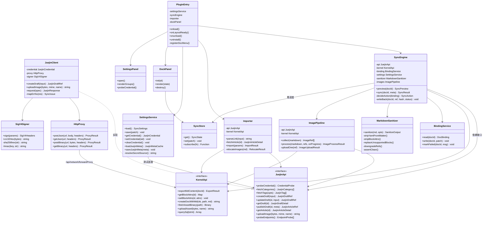
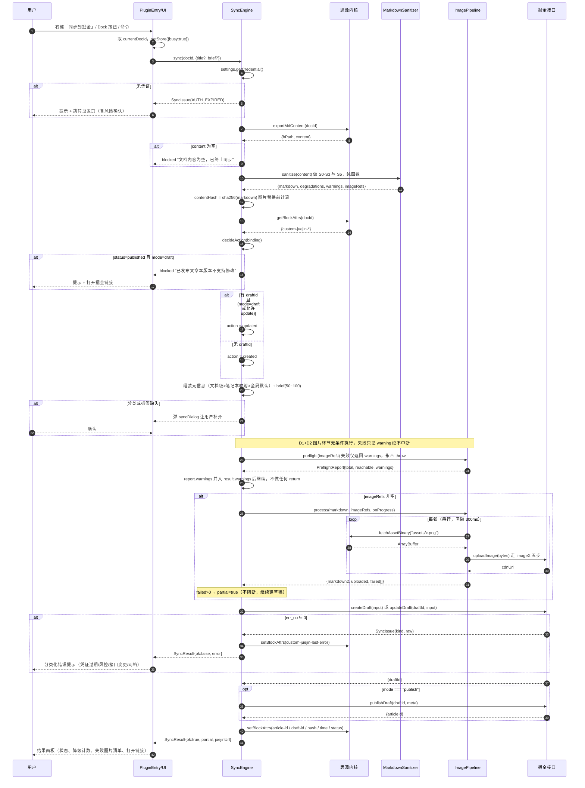
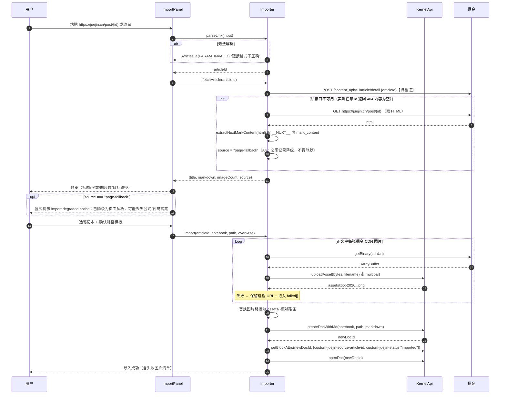
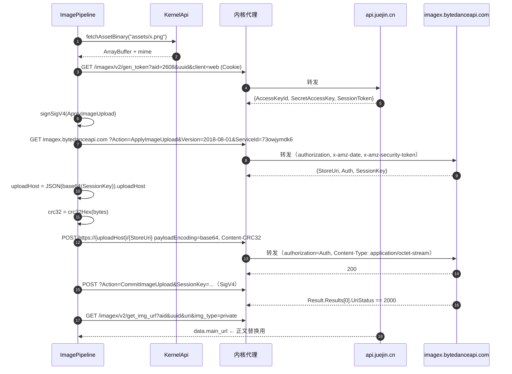

# ARCHITECTURE：siyuan-juejin-sync（思源笔记 ⇄ 掘金同步插件）

| 项 | 内容 |
| --- | --- |
| 文档版本 | **v1.2** |
| 作者 | 高见远（架构师） |
| 上游输入 | `docs/PRD.md` v1.1（426 行）+ 主理人齐活林范围裁定与已决策项（本文件优先级高于 PRD 冲突处） |
| 目标产物 | 可直接 `pnpm i && pnpm run build` 的思源插件工程 |
| 核实环境 | 思源内核 **v3.8.12**（本机 127.0.0.1:6806 实测）· `siyuan@1.3.0` 类型定义 · Node v24.19 · 掘金接口于 2026-11-25 在线实测 |

**v1.1 变更记录（相对 v1.0）**

| # | 变更 | 影响章节 |
| --- | --- | --- |
| 1 | 新增 **§0.1 已决策项 D1–D4**（图片转存不可裁剪 / 预检不阻断 / i18n 双语言零硬编码 / 错误原样透出），并逐条给出可验收落点 | §0.1 §5.2 §5.2.1 §6 §8.4.1 §8.5 §7-T1/T2/T4 |
| 2 | **推翻** v1.0 的「内核接口需 `Authorization: Token`」结论。实测：内核按**本机同源 Origin** 放行，**不需要 token**；伪造异源 Origin 才被拒。给出唯一推荐路径 + 单一兜底 | §1.6 §0（结论表） |
| 3 | 补入主理人核实的 `/api/asset/upload`（**已证实**）：字面量字段 `"file[]"`、`assetsDirPath`、`succMap` 语义；并据此定下反向导入的**唯一文件名规则** `juejin-<articleId>-<hash8>` | §3.3 §9-Q3.1 §7-T2/T5 |
| 4 | `JuejinApi.testConnection()` → **`probeCredential()`**，三态（valid/expired/unreachable）收敛在适配器内部，UI 不判 code，且不抛异常；新增 `CredentialProbe` 类型 | §3.1 §3.2 §3.4 §7-T2 §9-Q1 |
| 5 | 时序图移除「正文含本地图片 且 autoUploadImages」分支（与 D1 冲突），改为**无条件执行** preflight + process，并显式标注"不做任何 return" | §4.1 §5.2.1 |
| 6 | 文件数 38 → **41**（新增 `tests/i18n.test.ts`，并校正根/src/tests 计数） | §2 §7-T1 |

**v1.2 变更记录（相对 v1.1）**

| # | 变更 | 影响章节 |
| --- | --- | --- |
| 7 | **§11 由「待明确」改为「已裁定」**：主理人裁定 6 项（A1 摘要加/FR-06b、A2 minAppVersion 3.8.5、A3 图片失败清单**置顶不可折叠**、A4 反向导入降级**必须显式提示**、A5 接口自检按钮**暴露且默认折叠**、A7 凭证措辞**逐字规定**），每条附可验收要求 | §11 §8.5 §8.8 §4.2 §7-T4/T5 |
| 8 | **消除 S 编号不一致**：新增 §5.2.0「编号总览（唯一权威表）」；**`S6` 废弃，元信息组装改称 `M1`**。全文统一为「管线 = S0–S5」「全流程 = S0–S5 → M1」 | §5.2 §5.2.0 §2 §4.1 §8.2 §7-T3 |
| 9 | **新增 §5.3 摘要计数口径**：写死为 **Unicode 码点数**（禁用 `.length`/字节数/`.slice()`），目标带收敛到 60–90，并给出 emoji 反例说明 | §5.3 §7-T4 判据 13 |


> **确定性标注约定**（全文通用）
> - `【已证实】`：本文档作者在本机/线上**实测**得到明确响应，可直接照写。
> - `【据推断】`：来自公开可运行实现（`liuleihang/juejin-skills`，MIT，真实抓包产物）或官方类型定义，未在本机带凭证跑通。
> - `【待验证】`：无法核实，**必须**有 mock 与降级路径，失败时给用户可读提示。

---

## 0. 一页纸结论（给犹豫的人）

| 问题 | 结论 |
| --- | --- |
| 插件能不能直连掘金？ | **不能，且是硬性不能**。① 浏览器 `fetch` 禁止设置 `Cookie` 头；② 实测带 `Origin: http://127.0.0.1:6806` 请求 `api.juejin.cn` 返回 **HTTP 403**（WAF 拒绝）。详见 §1.2 |
| 那怎么调掘金？ | 全部走思源内核代理 `POST /api/network/forwardProxy`。**已实测**：可转发 `Cookie` 头、可用 `payloadEncoding:"base64"` 传二进制、单次响应上限 32 MiB。详见 §1.3 |
| 图片怎么传？ | 掘金图床走字节 ImageX **三段式 + AWS SigV4 签名 + CRC32 校验**，无单接口上传（旧 `images_upload/v1/create` 已下线，`image_api/*`、`resource_api/*` 实测 404）。详见 §1.4 / §9 |
| 思源 `assets/` 图片怎么读？ | **直接同源 `fetch('/assets/xxx.png')` 即可，无需 token**（实测 200 + 125290 字节完整返回）。详见 §9-Q3 |
| 凭证能不能加密？ | 能，但**不由本插件加密**：优先读思源「密钥和变量」的 `getSecret()`（内核侧加密）；插件 API 无写入密钥能力，故默认明文落盘 + UI 明示。详见 §9-Q8 |
| 要不要引入 Svelte？ | **不引入**。同意主理人判断，理由与替代方案见 §1.1 |
| 已发布文章能不能改？ | **没有直改接口**（`article/update`、`article/unpublish` 实测「请求路由不存在」），只能试 `article_draft/update`。降级方案见 §9-Q4 |
| 调内核接口要不要 token？ | **不需要**。内核按「本机访问校验」放行（同源 `Origin` 即通过）；伪造异源 Origin 实测被拒。详见 §1.6 |

---

## 0.1 已决策项（硬约束，**不设扩展位、不留开关、不得回退**）

> 以下 4 条来自主理人齐活林裁定 + PRD 更新版（426 行）§5.0 / §5.0.1 / §5.4 的 G-01、G-02。
> 工程师按此实现，**评审时不需要再讨论**；QA 按此专项验证。

| # | 决策 | 落地要求（可逐条验收） | 对应章节 |
| --- | --- | --- | --- |
| **D1** | **FR-08 图片转存属 P0，不可裁剪** | ① `ImagePipeline` 是被 `syncEngine` **无条件调用**的固定步骤，**不允许**出现 `if (!settings.autoUploadImages) return` 这样的"跳过同步主流程"分支——`autoUploadImages=false` 只允许降级为"不移交上传，但必须把本地图片引用按失败清单逐条列出并置 `partial`"，绝不能静默通过；② 不存在"关闭图片转存也能算 P0 完成"的路径；③ T3 任务不得被裁剪，T3 未完成即 P0 未完成 | §1.4 §5.2(S4) §7-T3 |
| **D2** | **图片预检失败仅告警、必须继续** | ① `syncEngine` 中**禁止**出现「预检失败 → `return`」或「预检失败 → 抛错」；② 预检只产出 `warnings[]` 与 `imageTotal`，然后**无条件**进入元信息收集与草稿提交；③ 单图取不到二进制时：该图进 `imageFailed[]`，其余图继续传，同步继续；④ 结果面板必现文案「图片预检不完整，部分图片可能未转存」 | §5.2 §7-T3/T4 |
| **D3** | **i18n 双语言，代码零硬编码中文** | ① `src/i18n/zh_CN.json` 与 `en_US.json` **key 集合完全一致**（T1 交付即需一条单测/脚本比对两侧 key，差集必须为空）；② `plugin.json` 的 `displayName`/`description`/`readme` 键与实际语言文件对齐；③ **`src/**/*.ts` 内不得出现任何中文字符串字面量**（含错误文案、按钮文案、日志面向用户的部分）；唯一例外：`console` 调试日志与代码注释。验收命令：`grep -rnP '"[^"]*[\x{4e00}-\x{9fa5}][^"]*"' src --include=*.ts` 命中数必须为 0（或逐条给出理由） | §8.5 §7-T1 |
| **D4** | **错误原样透出，不做内容审核/长度预判** | ① 掘金返回非 0 `err_no` 时，向用户展示：`err_no` + `err_msg` + HTTP 状态（若来自代理则含 `data.status`），**放在可折叠区域**，不加工、不翻译成"疑似敏感词"；② 代码中**禁止**出现敏感词表、正文长度上限判断、外链数量判断等任何前置校验/审核逻辑；③ 依赖清单里**不得**出现任何内容审核/敏感词类库（本设计运行时依赖为 0，天然满足）；④ 唯一保留的"长度相关"逻辑是 `brief_content` 的 **50–100 字组装**——那是**拼装合法入参**，不是校验拦截 | §8.4 §6 §11-A1 |

> 另有 **A1–A7 七项产品口径裁定**（摘要字段、minAppVersion、失败清单置顶、反向导入降级提示、接口自检按钮、标签 UI、凭证措辞），见 **§11「已裁定事项」**。D1–D4 与 A1–A7 共同构成冻结范围。

---

## 1. 实现方案与框架选型

### 1.1 UI 层：不引入 Svelte（保留原生 TS + DOM）

**结论：不引入 Svelte。** 与主理人倾向一致，但理由要说清楚，且必须给出响应式替代方案——否则状态一多就会写成一团。

| 维度 | 原生 TS + DOM | Svelte 5 |
| --- | --- | --- |
| 依赖体积 | 0 新增运行时依赖 | +`svelte` +`@sveltejs/vite-plugin-svelte` +`svelte-check` +`tsconfig/svelte` |
| 本项目 UI 实际规模 | 设置页（~20 控件）+ Dock 面板（状态横幅 + 2 个 tab）+ 1 个同步对话框 + 1 个结果面板，**全部是「表单 / 列表 / 按钮」形态，无复杂视图组合**，总计 ~1200 行 | 同样的东西用 Svelte 约 900 行，但多一套编译链 |
| 工程风险 | 无额外编译目标；QA 直接读 `.ts` 即可审 | Svelte 5 runes 与思源模板示例混杂；`svelte-check` 又是一道门禁 |
| 构建复杂度 | `vite build --config` 单入口 | 需 `vite-plugin-svelte` + `tsconfig` 分叉 |
| 收益 | 响应式需自己写 | 自动响应式 |

**关键判断**：本项目的"响应式复杂度"集中在**一个对象**上——`SyncState`（当前文档状态 + 同步进度 + 结果）。为它引入一个框架编译链不划算。

**替代方案（替代 Svelte 的，只有这 90 行）**：`src/core/store.ts` 提供一个 40 行的极简订阅容器。

```ts
export interface Store<T> {
    get(): Readonly<T>;
    set(patch: Partial<T> | ((prev: T) => Partial<T>)): void;
    subscribe(fn: (state: Readonly<T>) => void): () => void;
}
export function createStore<T extends object>(initial: T): Store<T>;
```
UI 组件在 `onMount`/初始化时 `subscribe` 一次，回调里做 `element.textContent = ...` / `classList.toggle(...)`——这正是原生 DOM 最擅长的部分。

**明确不做**：不做虚拟 DOM diff、不做组件树抽象。UI 文件内允许直接操作 DOM。

### 1.2 核心约束：为什么掘金请求必须经内核代理【已证实】

三个彼此独立、但指向同一结论的事实：

1. **浏览器禁止设置 `Cookie` 头**。`fetch` 的 `Cookie` 属于 forbidden header name，设置会被静默丢弃。掘金的全部鉴权就是 `Cookie: sessionid_ss=...`（见 §9-Q1）。
2. **实测掘金 WAF 拒绝异源 Origin**：
   ```
   POST https://api.juejin.cn/tag_api/v1/query_tag_list
        -H 'Origin: http://127.0.0.1:6806'          → HTTP/2 403
   同一请求去掉 Origin 头                              → HTTP 200 {"err_no":0,...}
   OPTIONS 预检 + Access-Control-Request-Method       → HTTP/2 403
   ```
3. **响应也不带 `Access-Control-Allow-Origin`**（第 1 项里 WAF 已经先拦了，第 2 项实测的 200 响应同样没有该头）。即便请求能出去，读响应也会被 CORS 拦。

⇒ 任何"在渲染进程里 `fetch('https://api.juejin.cn/...')`"的写法都是**必错**的。这不是"可能有风险"，是"一定失败的实现"。

### 1.3 内核对代理：`/api/network/forwardProxy`【已证实】

**实测命令与返回**（本机 3.8.12）：

```bash
POST http://127.0.0.1:6806/api/network/forwardProxy
Authorization: Token <kernel-token>
{
  "url": "https://api.juejin.cn/tag_api/v1/query_tag_list",
  "method": "POST", "timeout": 15000,
  "contentType": "application/json",
  "headers": [{"Content-Type":"application/json"}],
  "payload": "{\"cursor\":\"0\",\"limit\":2}",
  "payloadEncoding": "text"
}
→ {"code":0,"data":{"status":200,"contentType":"application/json; charset=utf-8",
                    "body":"{\"err_no\":0,\"err_msg\":\"success\",\"data\":[...]}",
                    "bodyEncoding":"text","headers":{...},"elapsed":1234}}
```

| 需求 | 实测结论 |
| --- | --- |
| 转发 `Cookie` 头 | ✅ 转发成功（`httpbin.org/headers` 回显 `"Cookie": "sessionid_ss=FAKE123"`） |
| 传二进制 | ✅ `payloadEncoding:"base64"` + `contentType:"application/octet-stream"`，`Content-Length` 按解码后字节计（实测 8 字节） |
| 取二进制响应 | `responseEncoding:"base64"`（官方 API.md 明确支持 `text`/`base64`/`base32`/`hex`） |
| 体积上限 | **32 MiB**（超出返回 `code:10` 且无 body）。单个 `assets` 图片通常远小于此；超限时降级为"跳过 + 失败清单" |
| 其他 | `redirect`（默认 true，跟随 ≤2 次）、`timeout`（默认 7000ms）、`headers` 为**对象数组** `[{k:v},{k:v}]` 而非 map（易踩坑，`proxy.ts` 内部封装掉） |
| 默认 UA | 内核用 `req/v3 (github.com/imroc/req)`，**必须**显式覆盖成浏览器 UA（参考实现里明确写了部分端点对 UA 敏感） |

`forwardProxy` 的返回值**不抛 HTTP 错误**：4xx/5xx 也走 `code:0`，状态码在 `data.status` 里。这一层封装必须做对，否则所有错误都变成"网络不可达"。

### 1.4 图片上传链路：ImageX 三段式【据推断 + 路由已证实】

掘金编辑器现在的图片上传**不是**一个接口，而是 5 步：

```
① GET  https://api.juejin.cn/imagex/v2/gen_token?aid=2608&uuid=<19位数字>&client=web   [Cookie]
   → data.token = {AccessKeyId, SecretAccessKey, SessionToken}          (STS 临时凭证)
② GET  https://imagex.bytedanceapi.com/?Action=ApplyImageUpload&Version=2018-08-01&ServiceId=73owjymdk6
   头: authorization=<AWS SigV4>, x-amz-date, x-amz-security-token
   → Result.UploadAddress.{StoreInfos[0].StoreUri, StoreInfos[0].Auth, SessionKey}
③ POST https://{uploadHost}/{StoreUri}                 （uploadHost 从 SessionKey base64 内 JSON 解出）
   头: authorization=StoreInfos[0].Auth, Content-CRC32=<8位hex>, Content-Type: application/octet-stream
   body: 图片原始字节
④ POST 同 ②的 host ?Action=CommitImageUpload&Version=2018-08-01&ServiceId=...&SessionKey=...
   头: 同 ② 的 SigV4
   → Result.Results[0].UriStatus == 2000 视为成功（偶发 201007 bad gateway，重试 1 次）
⑤ GET  https://api.juejin.cn/imagex/v2/get_img_url?aid=2608&uuid=<同一个uuid>&uri={StoreUri}&img_type=private
   → data.main_url   ← 这就是写进正文的 CDN URL
```

**已下线/不存在的路由**（实测，避免工程师再去找）：

| 探针 | 结果 |
| --- | --- |
| `POST /image_api/v1/upload_image` `/image_api/v1/get_token` `/resource_api/v1/upload_image` | `404 page not found`（该 host 路径根本不存在） |
| `POST /content_api/v1/image/upload` `/content_api/v1/upload_image` `/tag_api/v1/upload_image` | `{"err_no":2,"err_msg":"请求路由不存在"}` |
| `GET /imagex/v2/gen_token?...` / `GET /imagex/v2/get_img_url?...` | `{"err_no":403,"err_msg":"must login"}` ← **路由存在**，仅缺登录态 |

**技术要求（工程师必读）**：
- **SigV4 与 CRC32 必须用纯 TS 自实现**，不要依赖 `crypto.subtle`。原因：`crypto.subtle` 需要 secure context；桌面端 `http://127.0.0.1` 属 trusted origin 可用，但**移动端 WebView / 浏览器版思源可能不是**，一处不可用就是全盘不可用。纯 TS 实现约 150 行（`sha256` + `hmac` + `crc32`），可用固定测试向量验证，零运行时依赖、零环境依赖。
- SigV4 只需签 `x-amz-date;x-amz-security-token` 两个头，scope = `<yyyymmdd>/cn-north-1/imagex/aws4_request`【据推断】。
- `Content-CRC32` = IEEE CRC32，**小端序 8 位小写 hex**；缺失/错误服务端返回 `4007 MismatchChecksum`【据推断】。
- 上传得到的 URL 是 `img_type=private` 的签名 URL，掘金渲染层会动态重签，不必担心过期【据推断】。
- 全链路走 `forwardProxy`（含第 ③ 步的二进制直传），因为目标 host 同样是跨域 + 需要 `authorization` 自定义头。

### 1.5 架构分层

```
┌─────────────────────────────────────────────────────────┐
│ src/index.ts        插件生命周期 / 命令 / 右键菜单 / Dock 注册 │
├─────────────────────────────────────────────────────────┤
│ src/ui/*            settingsPanel · dockPanel · syncDialog  │
│                     resultPanel · components · styles       │
├─────────────────────────────────────────────────────────┤
│ src/core/*          syncEngine(编排) · importer(反向)        │
│                     markdown(纯函数) · images · brief        │
│                     binding(块属性) · settings · store       │
├─────────────────────────────────────────────────────────┤
│ src/api/*           juejin(唯一适配器) · juejinSign          │
│                     kernel(思源内核 RPC) · proxy(forwardProxy)│
├─────────────────────────────────────────────────────────┤
│ src/types.ts        全局契约（类型 + 常量 + 枚举）            │
└─────────────────────────────────────────────────────────┘
```
**依赖方向严格单向**：`ui → core → api → types`。`ui` 不得直接调 `api`；`core` 不得 import `ui`。这条约束决定了工程师可以并行写 T3/T4。

### 1.6 内核接口鉴权：**不需要 token**，靠「本机访问校验」【已证实】

> 上一版本我写的是"要带 `Authorization: Token`"。**该结论已作废**，以下是实测结论。

**实测三组对照**（本机 3.8.12，全部不带 `Authorization` 头）：

| 请求 | 附加头 | 结果 |
| --- | --- | --- |
| `POST /api/network/forwardProxy`（转发掘金标签列表） | `Origin: http://127.0.0.1:6806` | ✅ `{"code":0,...}` 正常拿到掘金数据 |
| `POST /api/attr/getBlockAttrs` | 同上 | ✅ `{"code":0,"data":{...}}` |
| `POST /api/export/exportMdContent` | 同上 | ✅ `{"code":0,"data":{...}}` |
| `POST /api/attr/getBlockAttrs` | `Origin: https://evil.example` | ❌ `{"code":-1,"msg":"认证失败：当前请求未通过本机访问校验..."}` |

⇒ 内核放行依据是**请求的 `Origin` 是否为本机同源**，与 `Authorization` 头无关。

**类型层面的佐证**：`siyuan@1.3.0` 里 `ISiyuan.config?: Config.IConf` 是 **optional**（`types/index.d.ts:90` 附近），`Config.IConf.api: IAPI = {token: string}` 存在但不是必达字段 —— 说明**内核 token 不是插件必须依赖的东西**，把它当成必经路径反而会在某些前端形态下 `undefined` 崩溃。

#### 唯一推荐路径（工程师照此写，不要临场判断）

| 场景 | 写法 | 说明 |
| --- | --- | --- |
| **一切 JSON 版 `/api/*`** | `import { fetchSyncPost } from "siyuan"` → `await fetchSyncPost("/api/xxx", body)` | 宿主已处理 host/鉴权/`Origin`，代码最短。`forwardProxy`、`exportMdContent`、`getBlockAttrs`、`setBlockAttrs`、`querySql`、`createDocWithMd` 全部走这条 |
| **multipart**（`/api/asset/upload`） | `fetch("/api/asset/upload", { method: "POST", body: formData })` ← **用相对路径，不拼 host、不拼 token** | `fetchSyncPost` 发不了 `FormData`；相对 URL 保证 `Origin` 同源，天然通过校验 |
| **读 assets 二进制** | `fetch("/assets/" + encodeURI(path))` | 【已证实】无 token → 200，body 完整 |
| **兜底（仅在上一条返回 `code:-1` 且 msg 含「认证失败」时）** | 重试一次，附 `Authorization: Token ${window.siyuan.config?.api?.token}`（取不到就**透出原始错误**，不要自己编文案） | 覆盖「浏览器版思源（远程访问）」「反向代理改写了 Origin」等边角场景 |

```ts
// api/kernel.ts 内部：唯一的兜底重试逻辑（不是主路径）
async function postJson<T>(path: string, body: unknown): Promise<T> {
    const res = await fetchSyncPost(path, body);
    if (res?.code === 0) return res.data as T;
    if (String(res?.msg ?? "").includes("认证失败")) return postJsonWithToken<T>(path, body); // 附 token 重试一次
    throw toKernelError(res);   // 原样透出 code/msg（见 D4）
}
```

**禁止**：把 token 写进日志或 `saveData`；为"拿 token"而在 `onload` 阶段抛错阻断插件加载。
**已知边界**：`browser-desktop` / `browser-mobile` 前端（远程访问思源）若 `Origin` 被判定为异机，会走兜底分支；若兜底仍失败，按 D4 原样透出内核 msg，并在结果面板提示「远程访问模式下请确认已登录思源授权码」。

---

## 2. 完整文件清单

> 路径均相对工程根 `/Users/yhl/WorkBuddy/2026-11-25-21-16-16/siyuan-juejin-sync/`
> 「行数量级」为预估，±50% 可接受。

### 2.1 根目录（11 个文件）

| 文件 | 职责 | 行数 |
| --- | --- | --- |
| `package.json` | 包声明、脚本（`dev`/`build`/`test`/`check`）、**仅 devDependencies** | ~40 |
| `pnpm-lock.yaml` | 由 `pnpm i` 生成，入库 | — |
| `vite.config.ts` | `build.lib` 入口 `src/index.ts`、`formats:["cjs"]`、`external:["siyuan","process"]`、`viteStaticCopy` 拷贝 `plugin.json`/`icon.png`/`preview.png`/`src/i18n/*.json` → `dist/i18n/` | ~75 |
| `vitest.config.ts` | 单测配置（`environment:"node"`，纯函数测试不碰 DOM） | ~15 |
| `tsconfig.json` | `target:ES2022`、`lib:["ES2022","DOM"]`、`moduleResolution:"Bundler"`、`strict:true`、`resolveJsonModule:true` | ~30 |
| `tsconfig.node.json` | 给 `vite.config.ts` 用（`types:["node"]`） | ~12 |
| `.gitignore` | `node_modules` `dist` `dev` `.DS_Store` | ~8 |
| `plugin.json` | 插件清单：`name` `author` `url` `version` `minAppVersion:"3.8.5"` `backends` `frontends` `displayName{default,zh_CN,en_US}` `description{...}` `readme{...}` `icon` `preview` `funding` `keywords` | ~35 |
| `icon.png` | **占位**：160×160 纯色 + 字母 "JJ"（工程师生成即可，不阻塞） | 二进制 |
| `preview.png` | **占位**：1024×512 同上 | 二进制 |
| `README.md` / `README_zh_CN.md` | 使用说明 + **风险声明**（非官方接口、凭证只存本地、默认只建草稿、不支持的块类型清单） | ~70 各 |

`plugin.json` 关键片段（照抄，别改结构）：

```jsonc
{
  "name": "siyuan-juejin-sync",
  "author": "<作者>",
  "url": "https://github.com/<org>/siyuan-juejin-sync",
  "version": "0.1.0",
  "minAppVersion": "3.8.5",
  "backends": ["windows", "linux", "darwin", "ios", "android", "docker"],
  "frontends": ["desktop", "desktop-window", "mobile", "browser-desktop", "browser-mobile"],
  "displayName": { "default": "Juejin Sync", "zh_CN": "掘金同步", "en_US": "Juejin Sync" },
  "description": { "default": "...", "zh_CN": "...", "en_US": "..." },
  "readme":      { "default": "README.md", "zh_CN": "README_zh_CN.md" },
  "icon": "icon.png",
  "preview": "preview.png",
  "funding": { "custom": [] },
  "keywords": ["juejin", "掘金", "publish", "blog"]
}
```
> `minAppVersion` 定 3.8.5 的理由：`plugin.saveData(storageName, content)` 双参形式与 `loadData(storageName)` 是该版本后的形态（`siyuan@1.3.0` 类型定义即如此）。**不做 3.1.x 兼容**，避免为多版本 storage 语义写分支。

### 2.2 `src/` 与 `tests/`（30 个文件）

| 文件 | 职责 | 行数 |
| --- | --- | --- |
| `src/index.ts` | 插件入口：`export default class extends Plugin`；`onload` 里 `addIcons`/`addCommand`/`addDock`；`onLayoutReady` 里注册文档树右键菜单（`eventBus.on("click-editortitleicon")`）；`onunload` 清理；持有各 Service 单例 | ~260 |
| `src/types.ts` | **全量契约**：设置、绑定、结果、掘金 DTO、`JuejinApi` interface、块属性 key 常量、错误枚举、i18n key 联合类型 | ~240 |
| `src/env.d.ts` | `*.json` / `*.scss` 模块声明；`window.siyuan` 补充声明（`config.api.token`、`config.lang`） | ~20 |
| `src/api/proxy.ts` | `forwardProxy()` 薄封装：超时、UA、headers 对象数组、`payloadEncoding` base64/text、`responseEncoding`、把 `code!=0` 与 `status>=400` 归一为 `ProxyError` | ~120 |
| `src/api/kernel.ts` | 思源内核 RPC：`exportMdContent` `getBlockAttrs` `setBlockAttrs` `createDocWithMd` `uploadAsset` `fetchAssetBinary` `querySql` `listNotebooks` `openDoc` | ~230 |
| `src/api/juejinSign.ts` | 纯 TS `sha256` / `hmacSha256` / `crc32Ieee` / `buildSigV4()` / `decodeSessionKeyHost()` | ~200 |
| `src/api/juejin.ts` | **唯一适配器**：`ENDPOINTS` 常量表 + `class JuejinClient implements JuejinApi`；所有 URL/字段名/err_no 解析只在此文件 | ~420 |
| `src/core/errors.ts` | `SyncError`、`ErrorKind` 枚举、`mapJuejinErrNo()`、`mapProxyError()`、i18n 文案 key 映射 | ~130 |
| `src/core/logger.ts` | `createLogger(scope)`，统一前缀 `[juejin-sync][scope]`，错误不落凭证（脱敏 `sessionid_ss=***`） | ~45 |
| `src/core/settings.ts` | 设置读写与默认值、凭证存取（密钥库优先 → 私有存储兜底）、`storageName` 常量、版本迁移 | ~190 |
| `src/core/binding.ts` | `readBinding(docId)` / `writeBinding(docId, patch)` / `clearBinding`，块属性 ↔ `DocBinding` 映射 | ~140 |
| `src/core/markdown.ts` | **清洗管线纯函数**（S0–S5，见 §5），`sanitize(md, opts) -> {markdown, degradations, warnings, imageRefs}` | ~330 |
| `src/core/brief.ts` | 摘要生成：去 Markdown 符号取纯文本 → 按 **Unicode 码点**补齐/裁剪到 60–90（安全带），硬区间 50–100（见 §5.3） | ~70 |
| `src/core/images.ts` | 图片提取 → 分类（local/remote/data）→ 串行上传（间隔 300ms）→ 原地替换 URL → 失败清单；含单文档内去重（P0）与持久缓存（P1 槽位） | ~260 |
| `src/core/syncEngine.ts` | 正向同步编排：状态机、绑定决策、元信息校验、调用管线、写回、`SyncResult` 组装 | ~340 |
| `src/core/importer.ts` | 反向导入：链接解析 → 抓正文（`__NUXT__` 提取）→ 图片回迁 → `createDocWithMd` → 写来源属性 | ~280 |
| `src/core/store.ts` | 极简订阅容器（§1.1）+ `SyncState` 定义 + 同步历史环形缓冲（最近 20 条） | ~95 |
| `src/ui/components.ts` | DOM 助手：`el(tag, attrs, children)`、`field()`、`select()`、`chipInput()`、`badge()` | ~150 |
| `src/ui/styles.scss` | 样式，全部用思源 CSS 变量（`var(--b3-theme-primary)` 等），不引皮肤 | ~230 |
| `src/ui/settingsPanel.ts` | 设置页三组（账号与凭证 / 同步默认值 / 高级实验性）、风险确认勾选、`probeCredential` 三态呈现、凭证存储形态直述（A7）、标签搜索 chips（A6）、**默认折叠的「接口自检」区块（A5）**、清除凭证 | ~470 |
| `src/ui/syncDialog.ts` | 同步前元信息确认：标题（可改）、摘要（自动生成可改）、分类、标签、模式提示 | ~210 |
| `src/ui/resultPanel.ts` | 结果面板：**失败图片清单置顶且不可折叠**（A3）、状态、降级计数、「技术详情 raw」独立折叠块（D4）、「仅重试失败图片」（P1 槽）、打开掘金链接 | ~200 |
| `src/ui/dockPanel.ts` | Dock：状态横幅 + 「同步/导入」两个 tab + 进度条（P1 槽） | ~290 |
| `src/ui/importPanel.ts` | 反向导入 tab：链接输入 → 预览（标题/字数/图片数 + **降级提示 A4**）→ 目标笔记本与路径 → 确认 | ~190 |
| `src/i18n/zh_CN.json` | 中文文案（约 150 key，见 §8.5） | ~170 |
| `src/i18n/en_US.json` | 英文文案，key 与上保持一致 | ~170 |
| `tests/markdown.test.ts` | 清洗管线单测（含真实导出样本） | ~180 |
| `tests/brief.test.ts` | 摘要 50–100 字边界 | ~50 |
| `tests/sign.test.ts` | SigV4 已知向量 + CRC32 已知向量（`crc32("123456789")==0xCBF43926`） | ~80 |
| `tests/i18n.test.ts` | **D3 门禁**：两侧 key 集合一致 + 源码零中文硬编码扫描 | ~70 |
| `tests/fixtures/*.md` | 3 份真实 `exportMdContent` 样本（含图片/块引用/表格/脚注/frontmatter） | — |

**合计 41 个文件**（= 根目录 11 + `src`/`tests` 30；不含 `pnpm-lock.yaml` 与 fixtures 目录内文件）。

---

## 3. 数据结构与接口

### 3.1 核心类型（`src/types.ts`）

```ts
/* ---------- 设置 ---------- */
export type PublishMode = "draft" | "publish";

export interface SyncSettings {
    riskAccepted: boolean;              // 未勾选不允许保存凭证
    defaultCategoryId: string;
    defaultTagIds: string[];
    notebookCategoryMapping: Record<string, { categoryId: string; tagIds: string[] }>;
    publishMode: PublishMode;           // 默认 "draft"
    autoUploadImages: boolean;          // 默认 true
    showInDocMenu: boolean;             // 默认 true
    titlePrefix: string;
    titleSuffix: string;
    appendLinkToDoc: boolean;           // P1
    syncTimeoutMs: number;              // 默认 30000
    requestIntervalMs: number;          // 默认 1000
    enableReverseImport: boolean;       // 默认 false
    reverseImportNotebook: string;
    reverseImportPathTemplate: string;  // 默认 "/博客导入/{{title}}"
    reverseImportOverwrite: boolean;
}

export interface JuejinCredential {
    sessionId: string;                  // sessionid_ss（或 sessionid）值
    savedAt: string;                    // ISO8601
    source: "vault" | "plugin-storage"; // 密钥库 or 插件私有存储（用于 UI 明示加密等级）
    userName?: string;                  // 探测成功后回填，便于用户确认身份
}

/* ---------- 凭证探测三态（FR-01 的唯一出口，UI 不得自己判 code） ---------- */
export type CredentialState = "valid" | "expired" | "unreachable";

export interface CredentialProbe {
    state: CredentialState;
    user?: JuejinUser;      // 仅 state==="valid" 时存在
    httpStatus?: number;    // 透出用（D4）
    errNo?: number;         // 透出用（D4）
    errMsg?: string;        // 原样，不加工
    elapsedMs: number;
}

/* ---------- 文档 ↔ 文章绑定（唯一事实来源 = 块属性） ---------- */
export type SyncStatus = "draft" | "published" | "failed" | "imported";

export interface DocBinding {
    articleId?: string;   // custom-juejin-article-id
    draftId?: string;     // custom-juejin-draft-id
    syncTime?: string;    // custom-juejin-sync-time
    status?: SyncStatus;  // custom-juejin-status
    contentHash?: string; // custom-juejin-content-hash
    categoryId?: string;  // custom-juejin-category-id
    tagIds?: string[];    // custom-juejin-tag-ids（逗号分隔存储）
    sourceArticleId?: string; // custom-juejin-source-article-id
    lastError?: string;   // custom-juejin-last-error
}

/* ---------- 掘金 DTO ---------- */
export interface JuejinCategory { id: string; name: string }
export interface JuejinTag      { id: string; name: string }
export interface JuejinUser     { userName: string; userId: string }

export interface DraftInput {
    title: string;
    briefContent: string;   // 50–100 字，硬校验
    categoryId: string;
    tagIds: string[];       // ≥1
    markdown: string;       // 已清洗 + 图片已替换
    coverImage?: string;    // P0 恒为 ""
}
export interface JuejinDraftRef   { draftId: string }
export interface JuejinArticleRef { articleId: string; draftId?: string }
export interface JuejinDraftDetail {
    draftId: string; title: string; markdown: string;
    categoryId: string; tagIds: string[]; articleId?: string;
}
export interface JuejinArticleDetail {
    articleId: string; title: string; markdown: string; status: number;
}

/* ---------- 同步结果 ---------- */
export type ImageRefKind = "local" | "remote" | "data";

export interface ImageUploadResult {
    kind: ImageRefKind;
    ref: string;          // 正文中出现的原始引用
    assetPath?: string;   // assets/xxx.png
    sourceUrl?: string;   // 远程图 URL
    cdnUrl?: string;      // 成功后掘金 CDN
    ok: boolean;
    reused?: boolean;     // 命中缓存/单文档内去重
    reason?: string;      // 失败原因（人类可读）
    elapsedMs?: number;
}

export interface Degradation {
    kind: "block-attr" | "block-ref" | "doc-ref" | "unsupported-block"
        | "footnote" | "inline-ext" | "remote-image";
    count: number;
    sample?: string;
}

export interface SyncResult {
    ok: boolean;              // 整体是否成功（无致命错误）
    partial: boolean;         // 成功但有失败图片/降级
    docId: string;
    action: "created" | "updated" | "skipped" | "blocked";
    status: SyncStatus;
    title: string;
    articleId?: string;
    draftId?: string;
    juejinUrl?: string;
    imageTotal: number;
    imageUploaded: number;
    imageFailed: ImageUploadResult[];
    degradations: Degradation[];
    warnings: string[];
    error?: SyncIssue;
    startedAt: string;
    elapsedMs: number;
}

/* ---------- 错误 ---------- */
export enum ErrorKind {
    AUTH_EXPIRED   = "auth_expired",    // 凭证失效
    NEED_PHONE     = "need_phone",      // 需绑定手机
    RISK_CONTROL   = "risk_control",    // 风控/限流
    API_CHANGED    = "api_changed",     // 接口下线/路由不存在
    PARAM_INVALID  = "param_invalid",   // 参数错误
    NOT_FOUND      = "not_found",       // 内容为空/已删除
    NETWORK        = "network",         // 网络不可达/超时
    KERNEL         = "kernel",          // 思源内核接口失败
    UNKNOWN        = "unknown",
}
export interface SyncIssue { kind: ErrorKind; message: string; i18nKey: string; raw?: string }
```

### 3.2 `JuejinApi` 契约（`src/api/juejin.ts` 对外只暴露这个接口）

```ts
export interface JuejinApi {
    /**
     * 【FR-01 唯一出口】凭证探测，三态收敛在适配器内部：
     *   valid       → err_no===0 且 data.user_name 存在
     *   expired     → err_no===403（must login）或 401
     *   unreachable → 代理 code!=0 / HTTP>=500 / 超时 / DNS 失败
     * 永不抛异常（UI 靠 state 分支渲染，不 catch 分类）。
     * 落点：GET /user_api/v1/user/get
     */
    probeCredential(): Promise<CredentialProbe>;

    /** GET /tag_api/v1/query_category_briefs?aid=2608 —— 注意必须 GET【已证实：POST 返回路由不存在】 */
    fetchCategories(): Promise<JuejinCategory[]>;

    /** POST /tag_api/v1/query_tag_list 全量翻页（cursor 步进 100，最多 10 页） */
    fetchTags(opts?: { maxPages?: number; onProgress?: (n: number) => void }): Promise<JuejinTag[]>;

    /** POST /content_api/v1/article_draft/create */
    createDraft(input: DraftInput): Promise<JuejinDraftRef>;

    /** POST /content_api/v1/article_draft/update  body.id = draftId【请求体字段待验证】 */
    updateDraft(draftId: string, input: DraftInput): Promise<JuejinDraftRef>;

    /** POST /content_api/v1/article_draft/detail body.draft_id【待验证】 */
    getDraft(draftId: string): Promise<JuejinDraftDetail>;

    /** POST /content_api/v1/article/publish body.draft_id + 元信息 */
    publishDraft(draftId: string, meta: DraftInput): Promise<JuejinArticleRef>;

    /** POST /content_api/v1/article/detail【待验证：实测任意 id 均 404 内容为空】 */
    getArticle(articleId: string): Promise<JuejinArticleDetail>;

    /** ImageX 三段式，返回 CDN URL；实现见 §1.4 */
    uploadImage(bytes: ArrayBuffer, mime: string, filename: string): Promise<string>;

    /** 诊断：逐个探针返回「可用 / 需登录 / 路由不存在 / 超时」，供设置页「接口自检」按钮使用 */
    probeEndpoints(): Promise<EndpointProbe[]>;
}

export interface EndpointProbe {
    name: string;            // "draft.create"
    url: string;
    reachable: boolean;      // 路由存在（哪怕 403 must login）
    determinism: "verified" | "inferred" | "unverified";
    observed?: string;       // 原始 err_no/err_msg，便于用户回报
}
```

### 3.3 `KernelApi` 契约（`src/api/kernel.ts`）

> `POST /api/asset/upload` 的字段与返回结构已由主理人核实，并经 `siyuan@1.3.0` 类型定义二次确认 **【已证实】**：
> `UploadAssetRequestInput = { "assetsDirPath"?: string; "file[]"?: Array<Blob>; "id"?: string }`
> `AssetUploadData = { errFiles: string[] | null; failedFiles: AssetUploadFailure[] | null; succFiles: AssetUploadSuccess[] | null; succMap: Record<string,string> | null }`
> 注意：字段名是**字面量 `"file[]"`**（带方括号），值是 `Blob[]`，不是 `File`/`ArrayBuffer`。

```ts
export interface KernelApi {
    exportMdContent(docId: string): Promise<{ hPath: string; content: string }>;
    getBlockAttrs(id: string): Promise<Record<string, string>>;      // POST /api/attr/getBlockAttrs
    setBlockAttrs(id: string, attrs: Record<string, string>): Promise<void>; // POST /api/attr/setBlockAttrs
    createDocWithMd(notebook: string, path: string, markdown: string): Promise<string>; // 返回新文档 id

    /** 读 assets 二进制：同源 fetch('/assets/x.png')，无需 token【已证实】 */
    fetchAssetBinary(assetPath: string): Promise<{ bytes: ArrayBuffer; mime: string } | null>;

    /**
     * 把二进制写入本地 assets（P2 反向导入必需；P1 外链转存可选）。
     * 实现：new FormData() → append("assetsDirPath", "assets/") → formData.append("file[]", new Blob([bytes], {type: mime}), filename)
     *       → fetch("/api/asset/upload", { method: "POST", body: formData })   ← 相对路径，不拼 host/token
     * 返回 value = succMap[filename] ?? succFiles[i].path，形如 "assets/xxx-20261125...png"
     * succMap 的 key 是**上传时的文件名**，value 是落盘相对路径；同名会被覆盖 → 文件名必须自带唯一前缀。
     */
    uploadAsset(bytes: ArrayBuffer, filename: string, mime: string, assetsDirPath?: string): Promise<AssetUploadOutcome>;

    querySql<T>(stmt: string): Promise<T[]>;
    listNotebooks(): Promise<Array<{ id: string; name: string }>>;
    openDoc(docId: string): void;   // 用 siyuan 包的 openTab/openMobileFileById，非内核接口
}

export interface AssetUploadOutcome {
    ok: boolean;
    /** 落盘相对路径，如 "assets/xxx.png"；ok=false 时为空串 */
    path: string;
    /** 原样透出的失败原因（D4），可能来自 failedFiles[0].error 或 errFiles 命中 */
    error?: string;
}
```

**反向导入时的文件名策略（硬要求，防覆盖）**：

```ts
// importer.ts
const hash8 = await sha256Hex(bytes).then(h => h.slice(0, 8));
const filename = `juejin-${articleId}-${hash8}.${extFromMimeOrUrl}`;   // 例：juejin-7703084122659504128-9f3a1c2e.png
```
理由：① `succMap` 以**文件名**为 key，同名会互相覆盖；② 同一篇文章重复导入/同图多引时靠 `hash8` 天然去重；③ 前缀 `juejin-<articleId>-` 让用户在 `assets/` 里一眼能看出这堆图是哪来的，配合 PRD R5「仅导入本人文章」的声明。

### 3.4 类图



---

## 4. 调用流程

### 4.1 正向同步（P0 主路径）



### 4.2 反向导入（P2）



### 4.3 图片上传子流程（`ImagePipeline` 内部，供实现参考）



---

## 5. Markdown 处理管线

### 5.1 实测到的输入形态（决定管线的依据）

用本机思源 3.8.12 对真实文档调用 `/api/export/exportMdContent`，得到：

| 观察 | 实测结果 |
| --- | --- |
| 是否有 YAML front matter | **有**，固定出现在首部：`---\ntitle: X\ndate: ...\nlastmod: ...\n---` |
| 是否有块属性 IAL `{: id="..." }` | 本次样本中 **0 处**（3.8.12 导出默认不写 IAL） |
| 块引用 `((id "text"))` | 导出后**已纯文本化**（正文里搜不到 `((`） |
| 图片语法 | `` |
| 脚注 | 保留 Markdown 脚注 `[^1]` |
| 表格 | GFM 管道表格 |
| 行内零宽字符 | 存在 `\u200b`（如 `` `synchronized`\u200b ``），**需清理**，否则掘金侧可能出现异常空格 |
| `siyuan://` 链接 | 本次样本 0 处 |

> **但管线仍必须处理 IAL 与 `siyuan://`**：① 用户在旧版本思源（≤3.1.x）或开启某些导出选项时会产出 IAL；② 自定义属性块（`custom-*`）在有属性时更易触发 IAL 输出；③ 超级块/数据库块内嵌内容形态不稳定。**清洗器必须"防御式"实现**，不能因为今天的样本干净就省掉规则——这正是 PRD FR-05 的验收项。

### 5.2 步骤顺序（**顺序即正确性**）

#### 5.2.0 编号总览（**唯一权威表，全文只认这 6 + 1 个编号**）

> 历史遗留问题已消掉：v1.0/v1.1 早期正文里出现过 `S6`（元信息组装）。**`S6` 已废弃**，元信息组装改用 `M1`（Meta）。任何文档、注释、提交信息里出现 `S6` 一律视为笔误。

| 编号 | 名称 | 归属文件 | 是否在"正文管线"内 | 是否有网络副作用 |
| --- | --- | --- | --- | --- |
| **S0** | 剥离 YAML front matter | `core/markdown.ts` | ✅ | ❌ 纯函数 |
| **S1** | 剥离块属性 / 行内 IAL / 零宽字符 | `core/markdown.ts` | ✅ | ❌ 纯函数 |
| **S2** | 不支持块 → 占位提示 | `core/markdown.ts` | ✅ | ❌ 纯函数 |
| **S3** | 块引用 / 文档引用 / `siyuan://` 降级 | `core/markdown.ts` | ✅ | ❌ 纯函数 |
| **S4** | 图片提取 → 上传 → 原地替换 | `core/images.ts` | ✅（唯一有 IO 的一步） | ✅ 网络 |
| **S5** | 兜底自检 + 降级计数 | `core/markdown.ts` | ✅ | ❌ 纯函数 |
| **M1** | 元信息组装（含摘要生成） | `core/brief.ts` + `core/syncEngine.ts` | ❌ **管线外** | ❌ 纯函数 |

- **正文管线** = **S0–S5**（`sanitize()` 做 S0/S1/S2/S3/S5，`ImagePipeline.process()` 做 S4）。
- **全流程** = `S0–S5` → `M1` → 提交草稿。
- 文档里凡是写"跑管线"的，一律指 **S0–S5**；凡是要表达完整同步流程的，写 **S0–S5 → M1**。

| 步 | 名称 | 输入 → 输出 | 为什么必须是这个位置 |
| --- | --- | --- | --- |
| **S0** | 剥离 YAML front matter | `---\ntitle..\n---\n\n# H1...` → `# H1...` | **必须最先**。frontmatter 里的 `title:` 含有文档标题文本，若留到后面，"取 H1 作标题""统计字数""摘要生成"都会被污染；且掘金正文里一段 `---` 会被渲染成水平线 + 一行 `title: xxx`。**实测确认它一定存在**，不是可选步骤。 |
| **S1** | 剥离块属性与行内 IAL | 去掉 `{: id="..." updated="..."}`、`{: style="..."}`、`{: custom-xxx="..."}`、`{: data-*="..."}` | 紧跟 S0。IAL 是**挂在块尾的元数据**，先删掉它，后续每一步面对的都是"干净的块内容"；若放在 S3（块引用降级）之后，`((id "text")){: id="x"}` 这类组合会残留半截 `{: id="x"}`。 |
| **S2** | 不支持块 → 占位提示 | `{{{row ...}}}`/`<iframe>`/挂件 HTML/`<video>`/数据库块 → `> [思源 超级块，暂不支持同步]` | **必须在 S3/S4 之前**。理由：挂件/iframe 的 HTML 里**可能包含** `![`、`assets/`、`{: ` 等模式，若先做图片提取，会把挂件内部的假图片当真实图片去上传（白传 + 报错清单污染）；先换成一行占位符，后续步骤不再看得到内部结构。 |
| **S3** | 引用与链接降级 | `((id "文本"))` → `文本`；`[[id]]`/`siyuan://` → 纯文本标题；块超链接 → 文本 + (URL) | 在 S4 之前。原因：降级的结果是**纯文本**，纯文本可能包含 `assets/` 字样（如用户正文里写了路径），但此时我们只做"引用→文本"的定点替换，不做扫描；把纯文本化提前，可以保证 S4 的图片扫描只面对"真正的图片语法"，不会误判。 |
| **S4** | 图片提取 → 上传 → 替换 | 扫描 ``（**先剔除代码围栏与行内代码段**）→ 分类 local/remote/data → 串行上传 → 原地替换 URL | **必须在最后（在所有纯文本变换之后）**。三个理由：① 这是全流程**唯一有网络副作用**的步骤，放最后可保证"前面任何一步失败都不会浪费上传"；② 只有前面清洗完成，正文才是最终形态，扫描出的图片集合才**准确**（否则可能为随后被占位符替换掉的块上传图片）；③ 纯函数（S0–S3）与 IO（S4）彻底分离，`tests/markdown.test.ts` 可以在**不联网**的前提下覆盖全部清洗逻辑，QA 不必准备掘金账号。 |
| **S5** | 兜底自检 + 计数 | 断言：无 `{: `、无 `siyuan://`、无未替换的 `assets/`；汇总 `degradations` 与 `warnings` | 最后一步，纯校验。命中即 `warnings.push()`，**不阻断**（符合 PRD"降级不阻断，失败信息收敛到结果面板"）。 |
| **M1** | 元信息组装（含摘要生成，原 `S6`） | 标题/摘要/分类/标签 → `DraftInput` | 与正文无关，放管线外（`syncEngine` + `brief.ts`）。摘要见 §5.3 的计数口径。**注意：这是"拼装合法入参"，不是长度校验拦截**（见 D4） |

#### 5.2.1 预检（Preflight）的唯一合法形态【D2 硬约束】

预检**不是管线的一步**，而是 S0–S3 的副产物 + 一次尽力而为的二进制可达性探测。它的输出只有两类：`warnings[]` 和 `imageTotal`。**没有任何分支能返回/中断同步**。

```ts
// images.ts —— 预检：允许失败，禁止阻断
export async function preflight(refs: ImageRef[]): Promise<PreflightReport> {
    const report: PreflightReport = { total: refs.length, reachable: 0, warnings: [] };
    for (const r of refs) {
        try {
            const bin = await kernel.fetchAssetBinary(r.assetPath!);
            if (bin) report.reachable++;
            else report.warnings.push(`preflight.miss:${r.assetPath}`);   // ← 只记 warning
        } catch (e) {
            report.warnings.push(`preflight.error:${r.assetPath}`);       // ← 只记 warning
        }
    }
    if (report.reachable < report.total) report.warnings.push("preflight.incomplete");
    return report;   // 永远 resolve，永远不 throw
}
```

**禁止清单**（QA 直接搜代码即可验证 D2）：
- ❌ `if (preflight.failed) return;`
- ❌ `throw new SyncError(...)` 出现在 preflight 内
- ❌ `if (report.reachable === 0 && report.total > 0) abort()`
- ✅ 唯一允许的后续动作：`if (report.warnings.length) result.warnings.push(...)` 然后**继续**执行 S4 正式上传与草稿提交

**关键实现细节**（工程师必看，踩过就知道）：

1. **图片扫描必须先剔除代码区域**，否则文章里举例的 `` 会被当成真图片去上传（参考实现里专门写了 `stripCodeRegions`）。剔除方式：先 `replace(/^(```|~~~)[^\n]*\n[\s\S]*?^\1[^\n]*$/gm, "")` 与 ``replace(/`[^`\n]*`/g, "")``，得到一个"用于扫描的副本"，**替换仍作用在原文上**。
2. **图片替换只替换 URL token，不替换整段 Markdown**。即 `map<target, cdnUrl>` 后用 `split(target).join(cdnUrl)` 作用于原文。避免破坏 `` 语法。
3. **`contentHash` 必须在 S4 之前计算**（对 S0–S3 的输出取 sha256）。理由：S4 会写入 CDN URL，每次上传的签名 URL 可能不同 → hash 永远变化 → "内容未变化跳过"（P1 FR-14）永远不成立。
4. **零宽字符清理**：`\u200b` 在 `` `code`\u200b `` 后出现是思源的行内标记残留，清洗时应统一 `text.replace(/\u200b/g, "")`（放 S1 末尾）。不做的话掘金渲染出不可见字符，用户复制会带空格。
5. **外链图片**：P0 保留原样 + `warnings.push("remote-image")`（防盗链风险）；**不删除、不阻断**。P1 再纳入转存。
6. **占位提示文案**统一走 i18n：`> [思源 超级块，暂不支持同步]`，且每类块计数一次进 `degradations`。
7. **`autoUploadImages=false` 不是"跳过图片环节"**（D1）。它的合法语义只有一种：**不上传，但必须把每个本地图片引用逐条写入 `imageFailed[]`（`reason:"upload-disabled"`）并把结果置 `partial`**，正文保留原路径。禁止出现"关掉开关 → 静默成功 → 用户以为图没问题"。设置项改名为更准确的 `uploadImagesToJuejin`（默认 true）亦可，但语义不得变。

### 5.3 摘要（`brief_content`）的字符计数口径（**写死，工程师照此实现**）

**口径：Unicode 码点数（code points），不是 UTF-16 长度，也不是字节数。**

```ts
// core/brief.ts —— 唯一允许的长度度量方式
export const countChars = (s: string): number => Array.from(s).length;   // ← 码点数
export const sliceChars = (s: string, n: number): string => Array.from(s).slice(0, n).join("");
// ❌ 禁止 s.length（UTF-16 单元数）、禁止 s.slice(0, n)（会切断代理对，产出半截 emoji 乱码）
// ❌ 禁止 Buffer/TextEncoder 字节数（中文 1 字 = 3 字节，会误判为超长）
```

**为什么选码点数，而不是 UTF-16 长度**：

| 文本 | 码点数 | UTF-16 `.length` | 差异后果 |
| --- | --- | --- | --- |
| 纯中文 60 字 | 60 | 60 | 一致，无差别 |
| 60 字 + 10 个 emoji（U+1F600 类） | 70 | **80** | 用 `.length` 会以为已 80 字而停止补齐，实际只有 70 字——若正文很短，可能停在下限附近，**边界抖动** |
| 全是 emoji × 30 | 30 | **60** | 用 `.length` 判定"够 60 字"，**实际 30 字 → 服务端（按字符计）判不足 50 → 建草稿被拒** |

选码点数的三个理由：
1. **与用户"字数"直觉一致**：中文/日文/韩文 1 字 = 1 码点，用户在对话框里数得清。
2. **对 emoji 安全**：UTF-16 会把 1 个 emoji 算 2，是唯一会让我们**误判"已够长"而实际不够**的方向——这个方向的错误会直接导致草稿被拒。
3. **最接近服务端口径**：掘金后端为 Go，按字符数校验时通常用 rune 计数（= 码点数）；即使它按字节计，中文重文本会"超上限"而非"欠下限"，用户能在对话框实时计数里看到并手动缩。

**安全带宽（必须实现）**：目标区间 `[50, 100]` 码点，实际生成时收敛到 **`[60, 90]`**：

```ts
export const BRIEF_MIN = 50, BRIEF_MAX = 100;      // 掘金硬限制
export const BRIEF_TARGET_MIN = 60, BRIEF_TARGET_MAX = 90;  // 我们自己的安全区
```
理由：① 覆盖服务端口径若为字节/字素簇导致的 ±10% 偏差；② 覆盖 ZWJ 组合 emoji（`👨‍👩‍👧` = 5 码点但视觉 1 字）这类极端情况；③ 用户在对话框里加几个字也不会立刻越界。

**UI 行为（FR-06b）**：
- 对话框「摘要」行实时显示 `countChars(v)/100`，`<50` 或 `>100` 时输入框变警示色 + `err.brief.range` 提示；**不阻断保存**（D4：不做前置拦截），但保存时若越界则在提交前**自动按码点裁剪/补齐到安全区**——这是"组装合法入参"，不是拦截。
- 提交后若掘金仍以 brief 相关原因拒绝，**原样透出 `err_msg`**（D4），并在提示里回显我们提交的 `brief_content` 码点数，便于用户判断口径差异。

---

## 6. 依赖包清单

> 原则：能自己写的不引包。**运行时依赖 0 个**（`siyuan` 由宿主注入，被 `external`）。

| 包 | 版本区间 | 类型 | 用途 |
| --- | --- | --- | --- |
| `siyuan` | `^1.3.0` | devDependencies | **仅类型与宿主 API 声明**：`Plugin` `Menu` `showMessage` `confirm` `openTab` `getFrontend` `fetchSyncPost` 等。构建时 `external:["siyuan","process"]`，运行由思源注入 |
| `vite` | `^6.3.5` | devDependencies | 构建；`build.lib` 出 `index.js`（cjs） |
| `typescript` | `~5.9.3` | devDependencies | 类型检查 `tsc --noEmit` |
| `@types/node` | `^22.10.0` | devDependencies | `vite.config.ts` 用 `node:fs`/`path` |
| `vitest` | `^2.1.9` | devDependencies | 纯函数单测（markdown/brief/sign）。**必须**——SigV4 与 CRC32 不靠单测验证等于赌博 |
| （可选）`sass` | `^1.80.0` | devDependencies | 若用 `styles.scss`；若嫌重，改成 `styles.css` 则**可不引**（推荐不引，直接用 CSS） |

**明确不引入**：`axios`（有 `forwardProxy` 封装）、`js-yaml`（frontmatter 只需正则剥离）、`js-sha256`/`crc-32`（自实现 ~150 行，避免 secure-context 依赖）、`marked`/`remark`（不做 HTML 转换）、任何 UI 框架。

**D4 连带约束：本节清单外不得新增任何"内容审核 / 敏感词 / NLP 文本检查"类依赖**（如 `bad-words`、`sensitive-word-filter`、任何云端审核 SDK）。`pnpm-lock.yaml` 差异评审时，若出现此类包直接驳回。运行时依赖为 0，天然满足该约束。

`package.json` 脚本：

```jsonc
{
  "type": "module",
  "scripts": {
    "dev":   "vite build --watch",
    "build": "npm run check && vite build",
    "check": "tsc --noEmit -p tsconfig.json",
    "test":  "vitest run",
    "test:i18n": "vitest run tests/i18n.test.ts"
  }
}
```

---

## 7. 任务列表（按依赖排序，5 个任务）

> 硬约束：≤5 个任务、每个 ≥3 个文件、配置文件集中在 T1。**T1–T4 完成即 P0 交付**；T5 含 P2（可裁剪，但其自查清单必须执行）。

### T1 · 工程骨架与契约层（P0）
- **源文件（17）**：`package.json` `tsconfig.json` `tsconfig.node.json` `vite.config.ts` `vitest.config.ts` `.gitignore` `plugin.json` `icon.png` `preview.png` `README.md` `README_zh_CN.md` `src/index.ts`(最小骨架) `src/types.ts` `src/env.d.ts` `src/i18n/zh_CN.json` `src/i18n/en_US.json` `tests/i18n.test.ts`
- **依赖**：无
- **优先级**：P0
- **完成判据**：
  1. `pnpm i && pnpm run build` 成功；`dist/` 内含 `index.js`+`plugin.json`+`icon.png`+`preview.png`+`i18n/zh_CN.json`+`i18n/en_US.json`。
  2. 软链到 `/Users/yhl/SiYuan/data/plugins/siyuan-juejin-sync/` 后思源插件列表可见、可启用、`onload/onunload` 无报错、设置页能打开空壳。
  3. **`pnpm test:i18n` 通过**（D3-V1）：两侧 key 差集为 0；且校验脚本对 `src/**/*.ts` 扫"中文硬编码"，命中数为 0。
  4. `plugin.json` 的 `displayName`/`description`/`readme` 三个键（`default`+`zh_CN`+`en_US`）齐全，指向文件存在（D3-V3）。
- **注意**：`src/index.ts` 此阶段只需继承 `Plugin` 并在 `onload` 打一行 `[juejin-sync][boot]` 日志，不要提前写业务。**i18n 从第一天就走 key**，别等到 T4 再补——D3 是回补成本最高的一条。

### T2 · 网络与 API 适配层（P0）
- **源文件（7）**：`src/api/proxy.ts` `src/api/kernel.ts` `src/api/juejinSign.ts` `src/api/juejin.ts` `src/core/errors.ts` `src/core/logger.ts` `src/core/settings.ts` + `tests/sign.test.ts`
- **依赖**：T1
- **优先级**：P0
- **完成判据**：
  1. `tests/sign.test.ts` 通过：`crc32("123456789") === 0xCBF43926`；SigV4 对固定输入产出固定签名（先跑一次生成黄金值，再断言，注释注明"由参考实现生成"）。
  2. `probeEndpoints()` 在真实环境输出：`draft.create`/`draft.update`/`draft.detail`/`article.publish` = 可达需登录；`article/update`、`article/unpublish` = 路由不存在；`query_category_briefs` 只有 GET 可达。
  3. **`probeCredential()` 三态各有用例**：正确 Cookie → `state:"valid"` 且带回 `user.userName`；错误/过期 Cookie → `state:"expired"`（**不是** `unreachable`）；断网或代理 `code!=0` → `state:"unreachable"`。三者均**不抛异常**，且都带上 `errNo`/`errMsg`/`elapsedMs` 供 UI 折叠展示（D4）。
  4. `kernel.uploadAsset()` 用固定 1×1 PNG 实测成功：`File` 字段名为 `"file[]"`、`assetsDirPath:"assets/"`，返回值取到 `assets/...png`；同名文件不覆盖（靠调用方传唯一文件名）。
  5. 日志里 `sessionid_ss` 全程显示为 `***`；**代码里没有任何 `crypto.subtle` 依赖**。

### T3 · Markdown 清洗与图片转存（P0）
- **源文件（6）**：`src/core/markdown.ts` `src/core/brief.ts` `src/core/images.ts` `tests/markdown.test.ts` `tests/brief.test.ts` `tests/fixtures/*.md`
- **依赖**：T2（用 `errors`、`kernel.fetchAssetBinary`、`juejin.uploadImage`、`logger`）
- **优先级**：P0
- **fixtures 从哪来**（不要凭空编造 Markdown，用真实导出样本）：
  ```bash
  # 注意：本机访问内核不需要 token（见 §1.6），只要是从本机发的请求
  curl -s -X POST -H 'Content-Type: application/json' \
    -d '{"id":"<文档id>"}' http://127.0.0.1:6806/api/export/exportMdContent \
    | python3 -c "import json,sys;print(json.load(sys.stdin)['data']['content'])" > tests/fixtures/sample-1.md
  ```
  取三类文档各一份：① 含本地图片的；② 含块引用/脚注/表格的；③ 含代码块且代码块内有 `` 字样的（用于验证"不误传"）。**入库前脱敏**（替换真实人名/内部链接）。
- **完成判据**：
  1. 3 份 fixtures 跑 S0–S5 后：无 `{: `、无 `siyuan://`、无残留 `assets/`（除非上传失败，且失败项在 `failed[]` 中）；S0 后无 `---\ntitle:`。
  2. 代码围栏内的 `` **不**被上传（断言 `imageRefs` 长度）。
  3. `brief` 长度恒在 `[50,100]`，边界用例（正文 20 字 / 正文 5000 字）都有断言。
  4. 上传失败时 `markdown` 保留原引用且 `ImageUploadResult.ok===false` 带 `reason`（**不抛异常**）。

### T4 · 同步编排与 UI（P0）
- **源文件（9）**：`src/core/store.ts` `src/core/binding.ts` `src/core/syncEngine.ts` `src/ui/components.ts` `src/ui/styles.scss`(或 `.css`) `src/ui/settingsPanel.ts` `src/ui/syncDialog.ts` `src/ui/resultPanel.ts` `src/ui/dockPanel.ts`
- **依赖**：T2、T3
- **优先级**：P0
- **完成判据**：
  1. 三个入口都可用：文档树右键菜单 / Dock 按钮 / 命令面板命令；`showInDocMenu=false` 时右键项消失；对笔记本、资源文件不显示菜单项。
  2. 首次配置闭环：粘贴 Cookie → 未勾风险确认时「保存」禁用 → **`probeCredential()` 三态分别有对应 UI 呈现**（有效显示账号名 / 已失效给出重新获取指引 / 不可达给出网络排查建议）→ 拉到分类与标签 → 选默认分类 + ≥1 标签 → 保存后重开设置页显示掩码。
  3. 真实同步一篇带本地图片的文档：掘金后台出现 1 篇草稿、图片不裂、块属性写回可读回（**D1**：这是 P0 的验收主路径，不允许"关闭图片转存后通过"）。
  4. 同一文档连续同步 3 次：掘金侧文章数恒为 1（无 `draftId` 时创建，有则更新）。
  5. `status=published` 时中止并提示，**不**新建第二篇。
  6. 图片失败 → 状态「部分成功」+ 结果面板列出失败路径。
  7. 错误分类正确：错误 Cookie → 「凭证已失效，请重新获取」；断网 → 「网络不可达」；**且「技术详情」折叠区里能看到原始 `err_no`/`err_msg`/`http`（D4）**。
  8. **D2 专项**：手动把某张 `assets` 图片改名/删除制造"预检失败" → 同步**仍然成功**创建草稿，结果面板出现「图片预检不完整」warning + 该图在失败清单中；代码中无 `preflight` 相关的 `return`/`throw`。
  9. **D3 专项**：把所有 UI 文案切到 `en_US`，界面无中文残留；`pnpm test:i18n` 通过。
  10. **A3 专项（失败清单置顶）**：造 1 张失败图片 → 结果面板**顶部**出现失败清单，**默认展开且不可折叠**；「技术详情（raw）」是单独的另一块 `<details>`，两者不得混在同一个折叠容器里。
  11. **A5 专项**：「高级 / 实验性」组内有默认折叠的「接口自检」区块，点击后逐行输出 `name/url/reachable/determinism/observed`。
  12. **A7 专项**：设置页凭证区显示的是「已存入思源密钥库」或「以明文保存在本地数据目录」二者之一；全项目搜不到"已加密/安全存储"字样。
  13. **A1 专项**：对话框摘要行显示 `n/100` 计数；输入 30 码点 → 提示但**可保存**，保存时自动补齐到 ≥50；输入 120 码点 → 自动裁到 ≤100；emoji 用例（30 个 emoji）字数显示为 `30`（码点口径，见 §5.3）。

### T5 · 反向导入 + 集成自查（P2 + 收尾）
- **源文件（3 + 文档）**：`src/core/importer.ts` `src/ui/importPanel.ts` `src/index.ts`（补全 Dock 的导入 tab 注册与命令）`README*.md` 更新
- **依赖**：T4
- **优先级**：P2（`enableReverseImport` 默认关闭；可裁剪但需评审同意）
- **完成判据**：
  1. `parseLink` 支持三种输入（完整 URL / `/post/{id}` / 纯 id），非法输入给出具体提示。
  2. 能取到标题与正文：**私接口优先**；私接口不可用时自动降级页面 `__NUXT__` 提取，**且预览区显式出现 `import.degraded.notice`「已降级为页面解析，可能丢失公式/代码高亮」**（A4，禁止静默降级）。
  3. 图片回迁成功写入 `assets/` 并替换链接；失败项保留远程 URL 并列在结果里。
  4. 重复导入同一 `article_id` 时提示覆盖/另存；写入 `custom-juejin-source-article-id` 与 `status=imported`。
  5. **集成自查清单**（即便裁剪 P2 也必须执行）：`onunload` 后无残留定时器/监听；`uninstall` 清空插件存储；移动端前端不报错（`getFrontend()==="mobile"` 时隐藏不支持的入口）。

### P1 增量槽位（不单独成任务，T2–T4 预留接口）
| FR | 落点文件 | 预留方式 |
| --- | --- | --- |
| FR-13 直接发布 | `syncEngine.ts` + `syncDialog.ts` | `settings.publishMode` 已有；`JuejinApi.publishDraft` 已在 T2 实现；补二次确认弹窗即可 |
| FR-14 更新已发布 + 内容 diff | `syncEngine.ts` | `contentHash` 已在 T3 计算；补「hash 相同 → skipped」分支 |
| FR-15 状态回写 | `syncEngine.ts` + `juejin.query_list` | `binding.status` 已留字段 |
| FR-16 图片缓存/重试/外链 | `images.ts` | 已留 `storageName="imageCache"` 与 `reused` 字段；`uploadImage` 重试 1 次 + 300ms 间隔已内置 |
| FR-17 结果面板重试 | `resultPanel.ts` | 结果结构已含 `imageFailed[]`（带 `assetPath`，可直接重投） |
| FR-18 批量同步 | `syncEngine.ts` + `dockPanel.ts` | `sync()` 无全局状态，串行 for 即可；`requestIntervalMs` 已有 |
| FR-20 限速退避 | `proxy.ts` | 已在 T2 实现最小间隔与 4xx 不重试 |

---

## 8. 共享知识约定

### 8.1 命名规范

| 对象 | 规范 | 示例 |
| --- | --- | --- |
| 文件名 | `camelCase.ts`；纯函数模块用名词 | `markdown.ts` `syncEngine.ts` |
| 类型/接口 | `PascalCase`，导出接口不加 `I` 前缀 | `SyncSettings` `JuejinApi` |
| 常量对象 | `SCREAMING_SNAKE_CASE` | `BLOCK_ATTR` `ENDPOINTS` `STORAGE_KEY` |
| 函数 | `camelCase`，动词开头 | `sanitize` `decideAction` `uploadOne` |
| 私有成员 | `private` + `camelCase`，不加下划线 | `private readonly api: JuejinApi` |
| 事件名（eventBus） | `siyuan-juejin-sync:<动作>` | `siyuan-juejin-sync:state-changed` |
| Dock type / 命令 langKey | `juejinSyncDock` / `juejinSyncDoc` / `juejinSyncImport` | 与 `plugin.json` 的 name 同前缀 |

### 8.2 块属性 key 常量（`src/types.ts`）

```ts
export const BLOCK_ATTR = {
    ARTICLE_ID:        "custom-juejin-article-id",
    DRAFT_ID:          "custom-juejin-draft-id",
    SYNC_TIME:         "custom-juejin-sync-time",     // ISO8601 UTC
    STATUS:            "custom-juejin-status",        // draft|published|failed|imported
    CONTENT_HASH:      "custom-juejin-content-hash",  // sha256 hex of S0-S3 output（图片替换前）
    CATEGORY_ID:       "custom-juejin-category-id",
    TAG_IDS:           "custom-juejin-tag-ids",       // 逗号分隔，无空格
    SOURCE_ARTICLE_ID: "custom-juejin-source-article-id",
    LAST_ERROR:        "custom-juejin-last-error",    // 人类可读，≤200 字
} as const;
```

### 8.3 存储 key（`saveData(storageName, content)` 双参，`minAppVersion≥3.8.5`）

```ts
export const STORAGE_KEY = {
    SETTINGS:  "settings",    // SyncSettings
    CREDENTIAL:"credential",  // JuejinCredential（独立文件，便于一键清除）
    META:      "juejinMeta",  // { categories, tags, fetchedAt }
    IMAGE_CACHE:"imageCache", // P1: { [assetPath+size]: cdnUrl }
    HISTORY:   "syncHistory", // 最近 20 条
} as const;
```

### 8.4 错误码映射（**基于实测响应**，`errors.ts` 照此实现）

| 观测到的响应 | `ErrorKind` | 用户可见文案（i18n key） |
| --- | --- | --- |
| `err_no:403, err_msg:"must login"` | `AUTH_EXPIRED` | `err.auth.expired`：「掘金凭证已失效，请重新获取 sessionid_ss」 |
| `err_no:403, err_msg:"must bind phone"` | `NEED_PHONE` | `err.needPhone`：「该掘金账号需先绑定手机号才能发布」 |
| `err_no:2, err_msg:"请求路由不存在"` | `API_CHANGED` | `err.apiChanged`：「掘金接口已变更（该功能暂不可用），请关注插件更新」 |
| `err_no:2, err_msg:"参数错误"` | `PARAM_INVALID` | `err.paramInvalid`：「掘金拒绝了请求参数：{msg}」 |
| `err_no:404, err_msg:"内容为空"` | `NOT_FOUND` | `err.notFound`：「掘金侧未找到该内容（可能已删除或无权限）」 |
| HTTP 429 / `err_no` 含「频繁」/「风控」 | `RISK_CONTROL` | `err.riskControl`：「操作过于频繁，已中止。请 {n} 分钟后再试」 |
| `forwardProxy` `code!=0`，或 `data.status>=500`，或超时 | `NETWORK` | `err.network`：「网络不可达或超时，请检查网络后重试」 |
| 思源 `/api/*` `code!=0` | `KERNEL` | `err.kernel`：「思源内核调用失败：{msg}」 |
| 其他 | `UNKNOWN` | `err.unknown`：「同步失败：{msg}」，**必须**附 `raw` 供用户回报 |

#### 8.4.1 原始信息透出规范【D4 硬约束】

「分类化文案」用于**让用户知道下一步做什么**；「原始信息」用于**让用户/开发者知道到底发生了什么**。两者**必须同时存在**，且原始信息不可被吞、不可被改写。

```ts
export interface SyncIssue {
    kind: ErrorKind;
    i18nKey: string;          // 给主文案
    params?: Record<string, string>;
    raw: {                    // ← 一律原样保留，渲染在结果面板的「技术详情」折叠区
        errNo?: number;       // 掘金 err_no（如 403 / 2 / 404）
        errMsg?: string;      // 掘金 err_msg 原文（如 "must login" / "请求路由不存在"）
        httpStatus?: number;  // 代理层 data.status；直连时用 response.status
        endpoint?: string;    // 如 "content_api/v1/article_draft/create"
        elapsedMs?: number;
    };
}
```

结果面板必须渲染成：

```
同步失败：掘金凭证已失效，请重新获取 sessionid_ss      ← i18n 主文案（kind=AUTH_EXPIRED）
▸ 技术详情                                              ← <details> 折叠，默认收起
    endpoint: content_api/v1/article_draft/create
    err_no: 403   err_msg: must login   http: 200   elapsed: 812ms
```

**明令禁止**（D4）：
- ❌ 任何敏感词表 / 关键词过滤 / 内容审核库（依赖清单里也不许有，见 §6）
- ❌ 正文长度上限校验、外链数量校验、标题长度校验等**前置拦截**
- ❌ 把 `err_msg` 改写成「可能是敏感词」「内容不合规」之类的猜测
- ❌ 对 `err_no != 0` 做无脑重试（4xx 一律不重试，只有 5xx/网络类才允许 1 次）
- ✅ 允许：`brief_content` 组装到 50–100 字（拼装合法入参，不是拦截）；`mark_content` 超 2 MiB 仅出 warning 不阻断

> 铁律：**永不吞掉 `err_msg`**。非官方接口随时会变，原样透出 `err_no/err_msg` 是唯一能让用户和开发者定位问题的方式。

### 8.5 i18n key 命名规则【D3 硬约束】

- 文件：`src/i18n/zh_CN.json`、`src/i18n/en_US.json`，**key 集合必须完全一致**（差集为空），构建时拷到 `dist/i18n/`。
- 命名：`<域>.<对象>.<动作/状态>`，全小写 + 点分层，禁止空格与中文 key。
- 域固定 6 个：`plugin` `settings` `sync` `image` `import` `err`。
- 插值用 `${name}`（思源模板惯例，如 `String(this.i18n.confirmRemove).replace("${name}", this.name)`）。

**三条强制校验（T1 就要落地，不要留到最后）**：

| # | 校验 | 命令 / 实现 | 通过标准 |
| --- | --- | --- | --- |
| V1 | 两侧 key 集合一致 | `node -e "const a=Object.keys(require('./src/i18n/zh_CN.json')),b=Object.keys(require('./src/i18n/en_US.json'));..."`（写进 `tests/i18n.test.ts` 更稳） | 缺/多均为 0 |
| V2 | 源码零硬编码中文 | `grep -rnP '"[^"]*[\x{4e00}-\x{9fa5}]' src --include=*.ts` | 命中为 0（注释与 `console` 调试日志除外，需逐条标注 `// i18n-exempt`） |
| V3 | plugin.json 声明对齐 | 人工核对：`displayName` / `description` / `readme` 的 `default` / `zh_CN` / `en_US` 三个键都存在，且指向的文件真实存在 | 全部存在 |

- 取值统一入口：`const t = (k: string, p?: Record<string,string>) => ...`，禁止 UI 里写 `this.i18n.xxx ?? "中文兜底"`（中文兜底 = 硬编码中文，违反 V2）。
- `plugin.json` 若在运行时发现标题未本地化，**允许**补 `zh-CN`/`en-US` 别名键（见 §9-Q10），但 `i18n/*.json` 文件名固定为 `zh_CN.json`/`en_US.json`。

示例（节选，完整 150 条按此风格）：

```jsonc
{
  "plugin.name": "掘金同步",
  "plugin.dockTitle": "掘金同步",
  "settings.group.account": "账号与凭证",
  "settings.sessionId.label": "掘金 sessionid_ss",
  "settings.sessionId.hint": "登录掘金 → F12 → Application → Cookies → 复制 sessionid_ss 的值",
  "settings.risk.confirm": "我已了解这是非官方接口，凭证可能失效，账号存在风险",
  "settings.risk.required": "请先勾选风险确认",
  "settings.test.button": "测试连接",
  "settings.test.ok": "连接正常，当前账号：${name}",
  "settings.credential.clear": "清除凭证",
  "settings.storage.vault": "已存入思源密钥库",
  "settings.storage.plain": "以明文保存在本地数据目录",
  "settings.selfcheck.title": "接口自检（高级 / 实验性）",
  "settings.selfcheck.run": "开始自检",
  "settings.tag.searchPlaceholder": "搜索标签",
  "sync.action.create": "同步到掘金（新建草稿）",
  "sync.action.update": "同步到掘金（更新草稿）",
  "sync.dialog.title": "确认同步信息",
  "sync.dialog.brief": "摘要（50–100 字）",
  "sync.dialog.briefCounter": "${n}/100",
  "sync.blocked.published": "该文章已发布，本版本不支持修改，请到掘金网页端编辑",
  "sync.blocked.empty": "文档内容为空，已终止同步",
  "sync.result.partial": "部分成功：${n} 张图片未转存",
  "sync.result.imageFailedTop": "以下 ${n} 张图片未能转存，发布前请先处理",
  "sync.result.degraded": "已降级 ${n} 处内容",
  "image.failed.list": "以下图片未能转存",
  "import.tab.title": "从掘金导入",
  "import.degraded.notice": "已降级为页面解析，可能丢失公式/代码高亮",
  "err.auth.expired": "掘金凭证已失效，请重新获取 sessionid_ss",
  "err.apiChanged": "掘金接口已变更（该功能暂不可用），请关注插件更新",
  "err.brief.range": "摘要建议 50–100 字（当前 ${n} 字）",
  "err.network": "网络不可达或超时，请检查网络后重试"
}
```

### 8.6 日志与脱敏

- 统一前缀：`[juejin-sync][<scope>]`，scope ∈ `boot` `settings` `juejin` `images` `markdown` `engine` `import` `ui`。
- **禁止**打印完整 Cookie；`logger.ts` 内置 `maskSecret(s)`：`sessionid_ss=abc...xyz` → `sessionid_ss=***`。
- 网络请求日志格式：`[juejin-sync][juejin] POST content_api/v1/article_draft/create → err_no=0 elapsed=812ms`（**不打 body**，正文可能上万字）。

### 8.7 时间与编码

- 所有时间字符串一律 **ISO 8601 UTC**（`custom-juejin-sync-time`、`credential.savedAt`）。展示时才本地化。
- 所有 HTTP body 一律 UTF-8 JSON；二进制一律 `ArrayBuffer` → base64（仅在 `proxy.ts` 边界转换）。
- **禁止**默认 `JSON.stringify` 带中文直接把 `payloadEncoding` 设为 `json`（内核会重复序列化），统一：`payload` 传**字符串** + `payloadEncoding:"text"`，`contentType:"application/json"`。

### 8.8 凭证读取优先级

```
1. plugin.getSecret("juejin-sessionid-ss")     ← 用户在「设置→密钥和变量」自建；内核侧加密；只读
2. saveData("credential") 中的 sessionId        ← 插件私有存储，明文
3. 无 → 引导去设置页
```
UI 必须显示 `credential.source` 对应的标记，**逐字使用 A7 裁定的措辞**（不得含糊、不得说"已加密"）：
- `source === "vault"` → `settings.storage.vault` = **「已存入思源密钥库」**
- `source === "plugin-storage"` → `settings.storage.plain` = **「以明文保存在本地数据目录」**


---

## 9. 待验证清单（供工程师与 QA 对照）

> 本节是**契约**。凡标 `待验证` 的，实现必须有：① 明确失败分支；② 用户可读错误；③ `probeEndpoints()` 里的探针条目。

### Q1 · 掘金四个私有接口的 URL / 请求体 / 鉴权【部分已证实】

| # | 能力 | 方法 + URL | 确定性 | 证据 / 备注 |
| --- | --- | --- | --- | --- |
| 1 | 凭证探测（FR-01 测试连接） | `GET https://api.juejin.cn/user_api/v1/user/get` | 路由**已证实**；返回 `data.user_name` **据推断** | 无参 → `{"err_no":2,"err_msg":"参数错误"}`（路由存在）；字段来自 juejin-skills `check.mjs`。**统一封装为 `probeCredential()`，三态收敛在适配器内，UI 不许自己判 code** |
| 2 | 分类列表 | `GET /tag_api/v1/query_category_briefs?aid=2608` | **已证实** | 实测 `err_no:0`，返回真实分类（`category_id`/`category_name`）。**必须 GET**：同 URL 用 POST 返回「请求路由不存在」 |
| 3 | 标签列表 | `POST /tag_api/v1/query_tag_list` body `{cursor:"0",limit:100}` | **已证实** | 实测 `err_no:0` 返回真实标签；`cate_id` 实测**不过滤**，须全量翻页（≤10 页）后本地匹配 |
| 4 | 创建草稿 | `POST /content_api/v1/article_draft/create` | 路由**已证实**（`403 must login`）；body **据推断** | body：`{category_id, tag_ids[], link_url:"", cover_image:"", title, brief_content, edit_type:10, html_content:"deprecated", mark_content, theme_ids:[]}`；返回 `data.id` = draft_id |
| 5 | 更新草稿 | `POST /content_api/v1/article_draft/update` body `{id: draftId, ...同 4}` | 路由**已证实**；body **待验证**（`id` vs `draft_id` 两写法都试） | 实测 `403 must login` |
| 6 | 草稿详情 | `POST /content_api/v1/article_draft/detail` body `{draft_id}` | 路由**已证实**；参数**待验证** | 实测 `403 must login` |
| 7 | 发布 | `POST /content_api/v1/article/publish` body `{draft_id, sync_to_org:false, column_ids:[], theme_ids:[], encrypted_word_count:0, category_id, tag_ids, cover_image, brief_content}` | 路由**已证实**（`403 must bind phone`）；body **据推断** | 返回 `data.article_id || data.id` |
| 8 | 文章详情 | `POST /content_api/v1/article/detail` body `{articleId}` | 路由存在、**行为未证实** | 实测：`article_id` → 「参数错误」；`articleId` / `id` → `404 内容为空`（真 id 亦然）。**不要依赖它做反向导入主路径** |
| 9 | 自有文章列表 | `POST /content_api/v1/article/query_list` | 路由**已证实**（未登录返回空列表 `has_more:false`）；登录后结构**待验证** | P1 状态回写用；预期含 `article_id` + `draft_id` |
| 10 | 草稿删除 | `POST /content_api/v1/article_draft/delete` | 路由**已证实** | 可选能力，P0 不用 |
| — | 鉴权形式 | 请求头 `Cookie: sessionid_ss=<value>`（`sessionid` 亦可） | **已证实可经 forwardProxy 转发**；掘金侧校验未带凭证实测 | 无需 CSRF token、无需签名头【据推断】 |
| — | 通用参数 | `aid=2608`；部分端点需浏览器 UA | **据推断** | `proxy.ts` 统一注入 UA |

### Q2 · 图片上传链路【已给出明确方案】
见 §1.4。结论：**无单接口**，必须 ImageX 三段式（5 步）。已下线路由清单见 §1.4 表格。全部经 `forwardProxy`；`SigV4`+`CRC32` 纯 TS 自实现。

### Q3 · 思源 assets 二进制读取【已证实】
- 实测 `GET http://127.0.0.1:6806/assets/<file>.png`：**无 token → 200，body 125290 字节完整**。
- `/assets/` 目录列表 → 403（正常，非错误）。
- 结论：渲染进程内 `fetch('/assets/' + encodeURI(path))` → `arrayBuffer()` 即可。**不要**走 `forwardProxy` 绕本地（多一次出网、无必要、且会丢 Cookie 语义）。
- 该路径同时用于 P2 反向导入后的本地校验。

### Q3.1 · 思源资源写入 `/api/asset/upload`【已证实】（主理人核实 + 类型定义二次确认）

| 项 | 结论 |
| --- | --- |
| 路径 / 方法 | `POST /api/asset/upload` |
| 体类型 | `multipart/form-data`（内核要求，非 multipart 会返回 `code:-1 "request Content-Type isn't multipart/form-data"`） |
| 字段 `assetsDirPath` | 形如 `"assets/"`（以 data 目录为根的相对路径）；**推荐恒用 `"assets/"`**，子目录有副作用 |
| 字段 `file[]` | **字段名就是字面量 `"file[]"`（带方括号）**，值类型 `Blob`，可多个 |
| 字段 `id`（可选） | 类型定义中存在，指向文档 id；本插件**不使用**（避免把资源绑定到具体文档） |
| 鉴权 | 同源请求即可（见 §1.6）；**不需要** `Authorization` 头 |
| 返回 | `{ code, msg, data: { errFiles: string[], failedFiles: {index,name,error}[], succFiles: {index,name,path}[], succMap: Record<string,string> } }` |
| 取值 | `succMap[上传时的文件名]` → `"assets/xxx-20261125...png"`；批量含同名时以 `succFiles[i].path` 为准 |
| **关键推论** | `succMap` 的 **key = 上传时的文件名，value = 落盘相对路径**；同名文件会被覆盖 ⇒ **调用方必须自带唯一前缀**。本设计用 `juejin-<articleId>-<hash8>.<ext>`（见 §3.3） |

补充：类型定义位置 `siyuan@1.3.0` → `types/api/index.d.ts` 的 `UploadAssetRequestInput` / `AssetUploadData`，工程师可直接引用，不必自己声明。

### Q4 · 能否更新已发布文章【已证实"无直改接口"，降级方案已定】
实测结论：

| 探针 | 结果 |
| --- | --- |
| `POST /content_api/v1/article/update` | `{"err_no":2,"err_msg":"请求路由不存在"}` |
| `POST /content_api/v1/article/unpublish` | `{"err_no":2,"err_msg":"请求路由不存在"}` |
| `POST /content_api/v1/article_draft/publish` | `{"err_no":2,"err_msg":"请求路由不存在"}`（发布只走 `/article/publish`） |
| `POST /content_api/v1/article_draft/update` | 路由存在（403 must login） |

⇒ **降级方案（写进代码）**：
1. `status=published` 且 `publishMode=draft` → **P0 直接中止**，提示「请到掘金网页端修改」，**不**创建新文章。
2. P1 若要做「更新已发布」：仅尝试 `updateDraft(draftId)`。
   - 成功 → 提示「已更新；若掘金未即时生效请到网页端确认」。
   - 失败且 `err_msg` 含「已发布/审核」→ 提示「本版本不支持修改已发布文章」+ 提供**「另存为新草稿」**按钮（**必须由用户点击**，绝不自动新建，避免重复文章污染）。
3. **不做**「取消发布→更新→再发布」两步流程：`unpublish` 接口不存在，此路不通。

### Q5 · 分类能否自动创建【未纳入范围】
未探测到创建分类的接口；本期**不做**。设置页在分类列表为空时给引导文案「请先在掘金网页端创建一个分类，再回来刷新」+ 「刷新分类」按钮。

### Q6 / Q7 · column_ids 与多账号【主理人已裁定不做】
`column_ids` 在发布 body 里**固定传 `[]`**；凭证模型单 `sessionid_ss`，`JuejinCredential` 不设 `accountId` 字段。

### Q8 · 凭证加密存储【已给出明确结论】
- **能加密，但不该由本插件自己加密**。`siyuan@1.3.0` 类型定义明确提供 `Plugin.getSecret(name): string`——「密钥在内核侧加密存储，此处读到的是运行时明文」。
- 但插件 API **只有 `getSecret`/`getVariable`（读），没有写入接口** ⇒ 插件无法替用户创建加密密钥。
- 因此最终设计（§8.8）：优先读密钥库同名项 → 否则用插件私有存储明文；UI **必须**明确标注「加密存储（思源密钥库）」/「本地明文存储」。
- **禁止伪加密**：不许自己 Base64/XOR 后当成"已加密"展示，那是欺骗用户。

### Q9 · 正文长度 / 敏感词限制【部分已证实】
| 限制 | 确定性 | 处理 |
| --- | --- | --- |
| `brief_content` **必须 50–100 字**，否则接口拒绝 | **据推断**（参考实现明确写"硬校验"，自动补齐逻辑） | 不阻断：`brief.ts` 自动生成到合法区间；对话框显示实时字数 |
| `mark_content` 建议 ≤ 2 MiB | 据推断（参考实现限制 2 MiB） | 超限仅 `warnings` + 提示，不阻断（PRD 不做前置校验） |
| 敏感词/外链数量硬限制 | **待验证** | 不做前置校验；掘金拒绝时原样透出 `err_msg` |

### Q10 · i18n【主理人已裁定】
提供 `src/i18n/zh_CN.json` + `en_US.json`，`plugin.json` 的 `displayName`/`description`/`readme` 声明 `default`+`zh_CN`+`en_US`。
⚠️ **风险点**：官方 2026 版模板的 `plugin.json` 用 `zh-CN`（连字符）。若实测界面标题未本地化，**补 `zh-CN`/`en-US` 别名键**（两个都留，无副作用）。列为 QA 检查项。

### 其他已知不确定性
| # | 事项 | 影响 | 处理 |
| --- | --- | --- | --- |
| U1 | `ServiceId=73owjymdk6`、`uploadHost` 兜底值 `tos-d-x-hl.snssdk.com` 是否长期有效 | 图片上传整体 | 常量集中在 `juejin.ts` 顶部；失败时报 `image.upload.failed` 并提示"掘金图床接口可能已变更" |
| U2 | `apply`/`commit` 的 SigV4 canonical query 是否需包含全部参数 | 上传失败 | 严格照 §1.4，单测固化签名黄金值；若失败，回退：改用 `StoreInfos[0].Auth` 直传 + 跳过 commit（若 `get_img_url` 仍可换 URL） |
| U3 | 移动端 `forwardProxy` 是否可用 | 移动端图片同步 | 已实测桌面可用；移动端未知 → T4 自查时若 `getFrontend()==='mobile'` 且代理失败，提示「移动端暂不支持图片转存，可关闭图片自动上传」 |
| U4 | 思源 ≤3.1.x 的 `saveData` 单参形态 | 老版本用户装不上 | `minAppVersion:3.8.5` 显式拦截，不做兼容 |
| U5 | 掘金草稿 `edit_type:10` 是否仍被接受 | 创建草稿 | 若报参数错误，试 `8`/省略；集中在 `DraftInput` 一处 |
| U6 | `article_draft/update` 对**已发布**文章的实际行为 | P1 FR-14 | 见 Q4 降级方案 |

---

## 10. 最大的架构风险（按严重度）

| 级 | 风险 | 缓解 |
| --- | --- | --- |
| **R-1** | **掘金私有接口随时变更**。已实测到 `query_category_briefs` 只认 GET、`query_category_tags`/`images_upload/v1/create` 已下线、`article/update` 不存在——这不是"可能变"，是"一直在变"。 | ① 全部 URL/字段集中在 `juejin.ts` 一个文件（≤420 行），变更时改一处；② `probeEndpoints()` 自检按钮让用户一键定位哪个接口挂了；③ `err_no:2 请求路由不存在` 专门映射为 `API_CHANGED`，文案直接告诉用户"接口已变更，等插件更新"；④ 永不吞 `err_msg` |
| **R-2** | **ImageX 图片链路最复杂且最难自证**（SigV4 + CRC32 + 5 步）。一处签名错就是全量图片失败，而失败只在"掘金上看到裂图"时才被发现。 | ① SigV4/CRC32 有黄金值单测；② 图片失败**不静默**：结果面板逐张列出 + 状态标「部分成功」；③ 上传前预检仅告警不阻断（PRD §5.0.1）；④ 提供「仅重试失败图片」的落点 |
| **R-3** | **CORS/Cookie 约束一旦被违反，实现必然全错**（工程师最容易上手就写 `fetch('https://api.juejin.cn')`）。 | ① `src/api/proxy.ts` 是**唯一**出网口，`juejin.ts` 不允许出现裸 `fetch`；② PR 自查项：`grep -r "fetch(\"https" src/` 必须为 0 命中（除 `kernel.ts` 的本地 `/assets/`）；③ 本文档 §1.2 已列实测证据 |
| R-4 | 思源 Markdown 方言与掘金渲染不对等，内容变形 | 降级规则表 + 计数器 + 结果面板可见；默认只建草稿，让用户在掘金侧二次确认 |
| R-5 | 映射关系写在块属性，用户手改会失联 | 保守策略：读不到 `article-id` 即视为未同步（宁可新建不误改），并在结果里提示 |

---

## 11. 已裁定事项（主理人 2026-11-25 裁定，**已生效，不再讨论**）

> §0.1 的 D1–D4 是"实现级硬约束"；本节是"产品口径裁定"。两者共同构成冻结范围，**工程师按此实现即可，不需要再来回确认**。

| # | 事项 | 裁定结论 | 落地要求（可验收） |
| --- | --- | --- | --- |
| **A1** | **`brief_content` 摘要字段** | **加**。掘金硬校验，不加则 P0 必然被拒。已同步补入 PRD **FR-06b** | ① 同步对话框内**一行**「摘要」，自动从正文生成、可编辑；② 目标区间 50–100 字，实现收敛到 **60–90 码点**安全带（见 §5.3）；③ 越界实时提示**但不阻断保存**（D4），提交前自动按码点裁剪/补齐；④ **不进全局设置**——每篇内容不同，全局默认无意义；⑤ 计数口径**写死为 Unicode 码点数**，实现见 §5.3 |
| **A2** | `minAppVersion` | **定 3.8.5**。不为 3.1.x 的 storage 语义写分支，收益不抵成本 | `plugin.json` 写 `"minAppVersion": "3.8.5"`；代码只支持 `saveData(storageName, content)` 双参形态 |
| **A3** | 图片失败是否仍建草稿 | **允许建**（与"部分成功"语义一致、与 D2 一致） | ⚠️ **失败清单必须置顶**、默认展开、**不可折叠**——原因：折叠后用户会带着裂图去发布。注意与 D4 的"技术详情折叠"区分：**折叠的是 `raw` 技术详情，不是失败清单** |
| **A4** | 反向导入正文来源优先级 | **私接口优先 → 失败自动降级页面 `__NUXT__` 提取** | 降级发生时，**必须在结果里显式标注**：`import.degraded.notice` =「已降级为页面解析，可能丢失公式/代码高亮」。不得静默降级 |
| **A5** | 「接口自检」按钮 | **暴露**，放「高级 / 实验性」组，**默认折叠** | 理由：R-1 是最高风险，用户遇到"路由不存在"时要能一键判断是插件坏了还是掘金改了。按钮触发 `probeEndpoints()`，结果表用 `<details>` 折叠，逐行显示 `name / url / reachable / determinism / observed`（D4 原样透出） |
| **A6** | 标签选择 UI | **搜索框 + 已选 chips**（本地过滤），不做 700+ 全量下拉 | `settingsPanel.ts` 内实现；标签全量缓存于 `juejinMeta`，支持按名/拼音首字母前缀过滤 |
| **A7** | 凭证存储形态的 UI 措辞 | **禁止模糊说法**。必须二选一，逐字使用：<br>• `credential.source === "vault"` → **「已存入思源密钥库」**<br>• `credential.source === "plugin-storage"` → **「以明文保存在本地数据目录」** | ❌ 禁止出现"已加密""安全存储""加密保护"等字样（除非确实来自密钥库）；禁止自造加密（Base64/XOR 冒充加密）。i18n key 见 §8.5 `settings.storage.*` |

