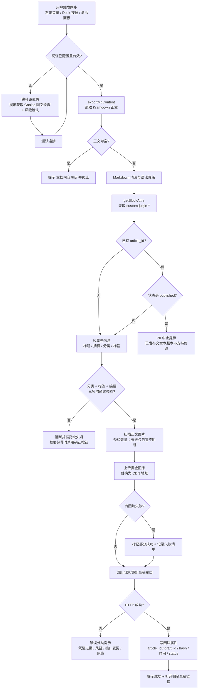
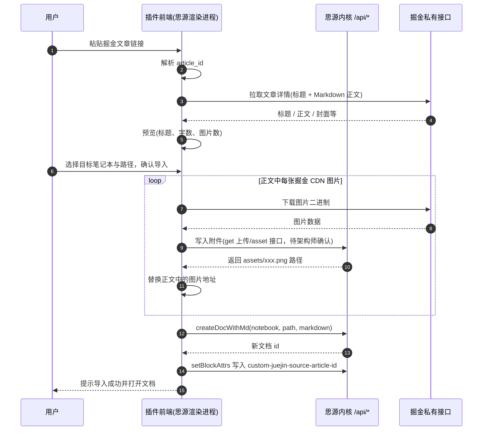
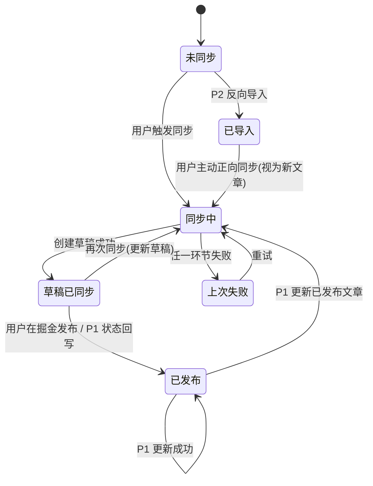

# PRD：siyuan-juejin-sync（思源笔记掘金同步插件）

## 1. 项目信息

| 项 | 内容 |
| --- | --- |
| Language | 简体中文 |
| Programming Language | TypeScript + Vite（基于思源官方模板 `plugin-sample-vite`），UI 用原生 DOM / 轻量组件，不强制 Svelte；国际化需提供 `src/i18n/`（`zh_CN` + `en_US`），详见 §5.4 G-01 |
| Project Name | `siyuan-juejin-sync` |
| 文档版本 | v1.0（首版） |
| 作者 | 许清楚（产品经理） |

### 原始需求复述

> 「设计一个思源笔记插件，可以将笔记内容同步作为掘金网站的博客。（可选）可以通过一个掘金文章链接，将文档内容转为本地的笔记」

即两条方向相反的数据流：

1. **正向**：思源文档 → 掘金文章（主需求）
2. **反向**：掘金文章链接 → 本地思源文档（可选需求，标为 P2）

---

## 2. 产品定位与目标

### 2.1 一句话定位

一个装在思源笔记里的「一键投稿」按钮：把已经写好的本地笔记，最小成本地变成掘金上的一篇文章，并把「哪篇笔记对应掘金哪篇文章」这件事记住。

### 2.2 Product Goals（3 个正交目标）

| # | 目标 | 说明 | 可衡量指标 |
| --- | --- | --- | --- |
| G1 | **消灭复制粘贴** | 用户在思源里写完即完成，不需要打开浏览器、手动搬运 Markdown、逐张重传图片 | 单篇文章从「点同步」到「掘金上出现草稿」≤ 3 次点击、无需离开思源 |
| G2 | **同步可重复、不产生重复内容** | 同一篇文档反复同步，始终操作同一篇掘金文章（更新而非新建）；文档与文章的绑定关系随文档走，换设备不丢 | 对同一文档连续同步 N 次，掘金侧文章数量恒为 1 |
| G3 | **默认安全，不给用户挖坑** | 因依赖掘金私有接口 + Cookie 凭证，产品必须默认「只建草稿、不公开发布」，凭证风险在首次配置时显式告知；任何不可用的能力都降级而非静默失败 | 首次配置必经风险确认页；同步失败必须给出可行动的错误原因（凭证过期 / 图片失败 / 接口变更），不允许白屏或静默丢内容 |

### 2.3 Non-Goals（明确不做）

> 标记「已决策」的条目为主理人齐活林确认的最终范围，**架构师不要在数据模型或设置项中为其预留字段**。

- 不做双向实时同步 / 冲突自动合并 —— 同步是**用户显式触发的一次性动作**
- 不做掘金侧数据回采（阅读量、点赞、评论）
- 不做其他平台（知乎 / CSDN / 公众号）
- 不做定时自动批量发布（无审核的自动公开推送风险过高）
- 不做「把掘金他人文章批量爬下来」
- **不做「发布到指定专栏」（`column_ids`）** —— 已决策。P1 也不预留字段。
- **不做自定义封面图** —— 已决策。封面由掘金默认取正文首图，插件不提供上传/选择入口，不预留字段。
- **不做多账号切换** —— 已决策。单账号、单个 `sessionid_ss`。理由：凭证本身已是高风险面（私有接口 + Cookie），多账号会成倍放大风控概率与凭证/映射状态管理复杂度，收益不足以支撑成本。
- **不在插件内维护敏感词库** —— 已决策。见 §5.4 关于内容校验的约定。

---

## 3. 目标用户与典型场景

### 3.1 目标用户

| 用户类型 | 特征 | 核心诉求 |
| --- | --- | --- |
| **A. 思源重度写作者**（主） | 已在思源积累几十~几百篇技术/读书笔记；想把这些内容分发到掘金获取曝光 | 「我不想再复制一遍，图片还得重传」 |
| **B. 双平台写作者** | 已经在掘金有账号和粉丝，但仍习惯在思源里写初稿 | 「草稿写完，一键推过去，再在掘金排版发布」 |
| **C. 内容回收者**（P2 用户） | 早期在掘金发过文章，想把存量文章收回本地做统一管理/二次加工 | 「给我一个链接，我把正文和图片都拿回来」 |

### 3.2 典型场景（≥3）

**场景 1｜首次配置（用户 A，一次性）**
用户在思源里看到插件图标，点「设置掘金账号」。插件弹窗给出图文步骤：登录掘金 → F12 → Application → Cookies → 复制 `sessionid_ss` 的值 → 粘贴。弹窗底部必须勾选「我已了解这是非官方接口，凭证可能失效，账号存在风险」。然后拉取并保存分类/标签列表，选好默认分类与至少一个默认标签。全程 ≤ 2 分钟。

**场景 2｜把一篇笔记推成掘金草稿（用户 A，高频，P0 主路径）**
用户在文档树上右键某篇笔记 → 「同步到掘金」→ 插件读正文、把 `assets/` 图片逐张上传到掘金图床并替换链接 → 组装标题/分类/标签 → 在掘金创建**草稿** → 文档顶部出现提示「已创建掘金草稿」，并附「在浏览器打开」链接。用户去掘金网页版微调排版后自行点击发布。

**场景 3｜笔记改了，再同步一次（用户 A，高频）**
用户改了笔记段落 → 再次同步 → 插件发现这篇文档已绑定掘金文章 → 执行**更新**而不是新建 → 提示「已更新掘金草稿（第 3 次同步）」。若该文章已在掘金被发布为正式文章，P0 阶段给出明确提示「该文章已发布，本插件 P0 不支持修改已发布文章，请到掘金网页端修改」，并**不执行**破坏性操作。

**场景 4｜只想发一篇，不想全量（用户 B）**
用户在 Dock 面板里看到当前文档的同步状态横幅：未同步 / 草稿已同步 / 已发布。点「同步」即可，无需理解 Cookie、接口等概念。

**场景 5｜把掘金老文章收回本地（用户 C，P2）**
用户开启「反向导入」，粘贴 `https://juejin.cn/post/7xxxxxxxxxxxxxxx` → 插件读取标题与 Markdown 正文 → 把正文中的掘金 CDN 图片下载并作为附件写入思源 `assets/` → 替换链接 → 用户选择目标笔记本 / 确认路径 → 创建思源文档 → 在文档上写入来源标记，避免同一篇被反向导入两次。

---

## 4. 用户故事

| # | 故事 | 优先级 |
| --- | --- | --- |
| US1 | **As a** 思源重度写作者，**I want** 在文档右键菜单里直接「同步到掘金」，**so that** 我不用打开浏览器手动复制正文和重传图片。 | P0 |
| US2 | **As a** 谨慎的新用户，**I want** 插件默认只给我创建草稿、且在我粘贴 Cookie 前明确告诉我风险，**so that** 我不会因误操作把没写完的内容公开发出去，也不会在不知情的前提下泄露账号凭证。 | P0 |
| US3 | **As a** 反复修改同一篇笔记的作者，**I want** 再次同步时更新原来那篇文章而不是新建一篇，**so that** 我的掘金主页不会出现一堆重复文章。 | P0 |
| US4 | **As a** 首次配置插件的用户，**I want** 插件能自动拉取我的掘金分类与标签让我勾选，**so that** 我不用去掘金页面找 `category_id` 这种数字 ID。 | P0 |
| US5 | **As a** 已经满意草稿排版的用户，**I want** 一个「直接发布」开关 / 按钮，**so that** 我可以跳过掘金网页端二次操作。 | P1 |
| US6 | **As a** 想回收历史内容的用户，**I want** 粘贴一个掘金文章链接就把正文和图片变成一篇本地思源笔记，**so that** 我可以把分散在两个平台的内容统一在一处管理。 | P2 |
| US7 | **As a** 凭证过期的用户，**I want** 插件明确告诉我「Cookie 已失效，请重新获取」，**so that** 我不会以为是插件坏了。 | P0 |

---

## 5. 需求池（P0 / P1 / P2）

> 优先级定义：P0 = 没有它产品不可用；P1 = 显著提升可用性/完成度；P2 = 可选加分项。

### 5.0 关于「图片转存」的优先级说明（**主理人已确认的最终范围，非可选**）

> **⚠️ 架构师请注意：本节拆分为主理人齐活林已明确确认的最终范围，FR-08 属于 P0 不可裁剪项，不得误判为 P1 可选能力。**

技术约束中已明确：**掘金对站外图片有防盗链，正文直接引用思源 `assets/xxx.png` 必然裂图。**

因此本 PRD 将图片能力**拆成两层**，而非整体放在 P1：

- **P0（FR-08）**：图片转存的**最小必需路径** —— 同步时把文档内所有 `assets/` 图片上传到掘金图床并替换正文链接。理由：没有它，P0 产出的草稿是裂图的，等于没交付。
- **P1（FR-16）**：图片转存的**增强** —— 去重缓存、失败重试与降级、非 `assets/` 外链图片处理、进度可视化。

#### 5.0.1 图片预检行为（**已定死，架构师与 QA 均按此实现**）

同步开始前会扫描正文并统计本地图片数量，此**预检仅作信息展示，永不阻断同步**：

| 情形 | 行为 |
| --- | --- |
| 预检成功，图片数 = 0 | 直接进入元信息收集与草稿提交（纯文字文章） |
| 预检成功，图片数 > 0 | 在结果面板展示「本次将转存 N 张图片」，然后继续 |
| **预检失败**（单图取不到 / 统计异常） | **仅告警，允许继续同步**。在结果面板标注「图片预检不完整，部分图片可能未转存」，由用户在同步结果面板查看最终失败清单 |

**设计理由**：预检属"提前探测"，若因单张图片取不到就整体阻断，会把一个可恢复的局部问题升级为全局不可用，用户体验更差。失败信息统一收敛到同步结果面板（FR-11 / FR-17），用户在发布前看到清晰失败清单即可自行决策。

#### 5.0.2 Markdown 降级规则表（P0）

| 思源语法 | 掘金侧处理 |
| --- | --- |
| 块属性 `{: id="..." updated="..."}` | 直接删除 |
| 块引用 `((id "文本"))` | 替换为纯文本「文本」 |
| 文档引用 `[[id]]` / 块超链接 | 替换为纯文本标题（无法跨平台跳转） |
| 思源 `assets/` 图片 | 上传后替换为掘金 CDN URL（FR-08） |
| 外链图片 `` | P0 保留原样并记录一条警告（防盗链风险）；P1 统一转存 |
| 超级块 / 数据库块 / 挂件 / iframe | 导出为占位提示 `> [思源 X 块，暂不支持同步]` |
| 高亮 `==text==` / 上下标等行内扩展 | 尽可能保留；不支持时降级为纯文本 |
| 脚注 | 保留 Markdown 脚注语法，若掘金不识别则降级为行内括号说明 |

#### 5.0.3 已知接口字段硬校验（**同步前必须本地一致校验，不得依赖提交后报错**）

| 字段 | 硬校验 | 产品侧处理 |
| --- | --- | --- |
| `brief_content`（摘要） | **50–100 字**，越界直接拒绝创建草稿 | 同步确认对话框内实时校验，越界禁用「确认同步」；详见 FR-06b |

> 该表为**登记表**，架构师后续实测到新的字段级硬校验时须回补至此，并在实现侧统一由常量表驱动校验，不散落在 UI 代码中（见 §9 R9）。

---

### P0 —— 单向同步（创建草稿）

| ID | 需求 | 说明 | 验收标准 |
| --- | --- | --- | --- |
| FR-01 | 掘金凭证配置与校验 | 设置页提供 `sessionid_ss` 输入（password 类型），支持「测试连接」。首次配置前置风险确认勾选。 | ① 未勾选风险确认时无法保存凭证；② 点击「测试连接」能在 5s 内返回「有效 / 已失效 / 网络不可达」三态之一；③ 凭证保存后再次打开设置页显示为掩码，不明文回显 |
| FR-02 | 分类与标签拉取 | 凭证有效后拉取用户的掘金分类列表与标签列表，供下拉多选。 | ① 成功拉取并持久化到插件私有存储；② 允许设置「默认分类」与「默认标签（≥1）」；③ 拉取失败时给出重试入口，不阻塞其他设置项 |
| FR-03 | 文档触发入口 | 提供三种入口：文档树右键菜单「同步到掘金」、Dock 面板内按钮、命令面板命令。 | ① 三个入口在开启/关闭开关控制下正确显示；② 对非文档块（如笔记本、资源文件）不显示该菜单项 |
| FR-04 | 读取文档正文 | 调用思源内核 `POST /api/export/exportMdContent`（入参 `id` = 文档块 id）取得 Kramdown 字符串。 | ① 能正确取到任意普通文档的正文；② 文档为空时提示「文档内容为空，已终止同步」并退出；③ 内核调用失败时提示具体错误并退出，不进入后续上传步骤 |
| FR-05 | Markdown 清洗与降级 | 剥离思源专有标记（块属性 `{: id="..." ...}`、`{: custom-...}`、块引用 ID 等），把不支持的语法降级。 | ① 清洗后正文不出现 `{: ` 残留、不出现 `siyuan://` 协议链接；② 降级规则表见 §5.0.2；③ 降级发生时在结果提示里列出「已降级的 N 处内容」 |
| FR-06 | 元信息收集 | 同步前（或首次）确定四项：标题（默认取文档标题，可编辑）、**摘要 `brief_content`（见 FR-06b）**、分类 `category_id`、标签 `tag_ids`（≥1）。 | ① 标题可改且长度校验；② 未选分类或未选到 1 个标签时阻断同步并提示；③ 优先使用当前笔记本的映射配置，其次用全局默认；④ 四项全部通过校验才允许提交 |
| FR-06b | **文章摘要 `brief_content`（P0，架构师实测的硬校验）** | 掘金创建草稿接口对 `brief_content` 有 **50–100 字硬校验**，不在区间直接拒绝创建。同步确认对话框中新增「摘要」一行：默认从正文自动生成（剥离 Markdown 符号取纯文本，截到 50–100 字区间）；可编辑，超界实时提示并阻断；**不做全局设置**（摘要随内容变化，全局默认无意义）；自动生成失败时以正文原文填充并提示手动补充。 | ① 正文 ≥ 50 字的文档，打开同步对话框时摘要框预填长度落在 `[50,100]`；② 摘要 <50 或 >100 时「确认同步」按钮禁用并显示当前字数；③ 正文 <50 字时提示「正文过短，请手动填写摘要（50–100 字）」，**不得静默截断或静默放行**；④ 设置页中不存在任何摘要相关字段；⑤ 摘要原样作为 `brief_content` 提交，不得再做二次裁剪 |
| FR-07 | 创建掘金草稿 | 调用掘金「创建草稿」私有接口，把**标题、摘要 `brief_content`、Markdown 正文、分类、标签**写入。**默认不调用发布接口。** | ① 成功后掘金后台可见一篇草稿，标题/摘要/正文/分类/标签与插件设置一致；② 返回的 `draft_id` / `article_id` 被持久化；③ 同步完成提示中提供「在浏览器打开草稿」链接；④ 提交的 `brief_content` 与对话框内用户可见内容完全一致（长度在 `[50,100]`） |
| FR-08 | 图片转存（最小路径）**P0 不可裁剪** | 扫描正文中的本地图片（`assets/xxx.png` 等思源相对路径），读取二进制 → 上传掘金图床 → 把正文里的地址替换为掘金 CDN 地址。**预检仅告警不阻断，见 §5.0.1。** | ① 正文中所有本地图片在掘金侧预览时正常显示、无裂图；② 上传单图失败时不得静默跳过，需在结果中列出失败图片路径；③ 替换仅作用于图片 URL，不破坏其余 Markdown 语法；④ 图片转存失败数 > 0 时，同步结果标记为「部分成功」并提示可重试；⑤ **预检失败时必须继续执行同步**，仅展示告警文案，不得阻断 |
| FR-09 | 文档↔文章映射写入 | 把掘金侧标识写回文档根块的块属性，作为唯一事实来源。字段见 §7。 | ① 属性写入后可用 `getBlockAttrs` 读回且值正确；② 关闭思源重开、或换设备（笔记同步后）仍能读取到映射；③ 属性名统一使用 `custom-juejin-*` 前缀 |
| FR-10 | 重复同步防重（更新已存在的草稿） | 同步前先读块属性：无 `article_id` → 创建；有 → 更新同一篇。 | ① 对同一文档连续同步 3 次，掘金侧文章总数恒为 1；② 若目标文章已被发布为正式文章，P0 阶段中止并提示「已发布文章不支持本版本修改」，**不得**新建重复文章 |
| FR-11 | 结果反馈与状态展示 | Dock 面板显示当前文档同步状态徽标；每次同步给出明确结果。 | ① 状态枚举覆盖：未同步 / 同步中 / 草稿已同步 / 已发布 / 上次失败；② 失败信息包含可行动原因，不只显示「失败」 |
| FR-12 | 设置项持久化 | 所有设置存入插件私有存储 `saveData()`；凭证与其他配置分离存放。 | ① 重启思源后设置不丢失；② 提供「清除凭证」按钮，一键清除后不影响其他设置 |

---

### P1 —— 直接发布 / 更新已发布文章 / 图片转存增强

| ID | 需求 | 验收标准 |
| --- | --- | --- |
| FR-13 | 直接发布（可选开关） | ① 设置中 `publishMode` 可切为 `publish`，此时同步后直接创建/发布为公开文章；② 切为 `publish` 时必须二次确认弹窗，文案明确「将立即公开到掘金」；③ 默认值恒为 `draft` |
| FR-14 | 更新已发布文章 | ① 对已发布的映射文章执行更新，掘金侧正文同步变更；② 更新前对比内容 hash，无变更时提示「内容未变化，跳过」；③ 更新失败不破坏线上原文 |
| FR-15 | 发布状态回写 | ① 通过接口或文章详情得知文章已发布后，块属性 `custom-juejin-status` 更新为 `published`；② 状态与实际一致 |
| FR-16 | 图片转存增强 | ① 同一图片（同 path + 同 hash）在多次同步中不重复上传（本地缓存）；② 单图失败自动重试 1 次，仍失败则以原图占位并在结果中列出；③ 外链图片也纳入转存；④ 上传过程显示进度（已上传 x/y） |
| FR-17 | 同步结果面板 | ① 展示每张图片的上传结果与耗时；② 支持「仅重试失败项」 |
| FR-18 | 批量同步 | ① 可对选中的多个文档执行同步；② 串行执行并有全局进度，避免触发风控；③ 中途失败不中断其余任务 |
| FR-19 | 同步后在文末追加掘金链接 | ① 设置项控制；② 追加位置在文末，格式为一行引用；③ 不污染原有内容（可通过再次关闭开关后手动清理） |
| FR-20 | 请求限速与退避 | ① 连续请求间有最小间隔（≥1s）；② 遇到 4xx（风控/鉴权）时中止并提示，而非无脑重试 |

---

### P2 —— 反向导入（掘金链接 → 本地思源笔记）

> 用户原话为「可选」，故定为 P2，但**设计完整**，P0/P1 交付后即可排期。

| ID | 需求 | 验收标准 |
| --- | --- | --- |
| FR-21 | 反向导入入口 | ① 设置中 `enableReverseImport` 开关（默认关闭）；② 开启后 Dock 面板出现「从掘金导入」tab；③ 命令面板提供同名命令 |
| FR-22 | 链接解析 | ① 支持输入完整文章 URL、`/post/{id}` 形式 URL、纯 article_id 三种形式；② 非法输入给出具体提示；③ 正确提取 `article_id` |
| FR-23 | 读取文章内容 | 取得文章标题与 Markdown 正文（来源：掘金文章详情类私有接口，具体接口**待架构师确认**）。验收：① 能拿到标题与正文；② 文章不存在/已删除/私密无权限时给出区分提示 |
| FR-24 | 图片回迁 | ① 正文中的掘金 CDN 图片下载后写入思源 `assets/`；② 正文链接替换为思源 `assets/` 相对路径；③ 任一张图下载失败时保留原远程 URL 并在结果中列出 |
| FR-25 | 目标位置选择 | ① 可选择目标笔记本与父文档/路径；② 提供路径模板（默认 `/博客导入/{{title}}`）；③ 支持「先预览再创建」 |
| FR-26 | 创建本地文档 | 调用思源 `POST /api/filetree/createDocWithMd` 创建文档。验收：① 文档创建成功且正文/图片正常；② 成功后自动打开该文档；③ 重名时使用路径模板去重（追加序号）而非报错 |
| FR-27 | 反向导入去重 | ① 写入 `custom-juejin-source-article-id`；② 再次导入同一 article_id 时提示「已导入过，是否覆盖/另存」 |
| FR-28 | 反向导入后的状态标记 | ① 文档状态标记为 `imported`，不显示「同步到掘金」的默认更新路径；② 若用户主动正向同步该导入文档，视为新文章处理（避免污染原文章） |

---

### 5.4 全局工程约定（跨 P0~P2 适用，不占用 FR 编号）

#### G-01 国际化（主理人已决策，架构师需在文件清单中包含 `src/i18n/`）

| 项 | 要求 |
| --- | --- |
| 语言集 | `zh_CN` 与 `en_US` **两套语言文件**，不提供更多 |
| 默认语言 | 跟随思源客户端语言；无法判定时回落 `zh_CN` |
| 文案质量 | **中文为基准文案，必须人工审校**；英文允许机翻级别，但不得出现占位符未替换、key 裸露、明显乱码 |
| 文件组织 | `src/i18n/zh_CN.json`、`src/i18n/en_US.json`（思源插件约定的 i18n 目录与文件命名以架构师核实为准） |
| 声明完整性 | `plugin.json` 中 i18n 相关声明**必须完整填写**，不得只声明 `zh_CN` 而遗漏 `en_US` |
| Key 覆盖 | 两套 key 集合必须完全一致；缺失 key 时回落中文并输出一条 console 警告 |
| 范围 | 界面文案、按钮、提示、错误信息、设置项 label 与说明全部纳入 i18n；**不翻译**文档内容、日志、块属性名 |

**验收**：① 切换语言后插件所有可见文案随之切换，无硬编码中文残留；② 两套 JSON 的 key 差集为空（可脚本校验）；③ `plugin.json` 声明与 `src/i18n/` 实际文件一致。

#### G-02 内容校验边界（主理人已决策）

**不在插件内做正文长度、敏感词、外链数量的前置校验。**

- 插件不做任何"发布可行性"预判，避免因平台规则变动导致误判与漏判。
- 仅在**掘金接口拒绝请求时**，把原始 `error code` 与 `message` **原样透出**给用户（含 HTTP 状态码），归入既有的错误分类「接口变更 / 风控」。
- 明确不引入敏感词库：维护成本高、误判风险大、且与插件"搬运工具"的定位不符。
- **验收**：① 接口返回业务错误时，用户能看到掘金原始错误码与 message（可折叠展示）；② 插件代码与依赖中不存在任何敏感词表/正则拦截逻辑。

---

## 6. 核心交互流程

### 6.1 正向同步（P0 主路径）

### 6.2 反向导入（P2）

---

## 7. 数据与状态约定

### 7.1 文档 ↔ 掘金文章映射（存于文档根块块属性）

**设计取舍：为什么用块属性而不是插件私有数据库？**
块属性随文档一起被思源同步/导出，换设备、换思源实例都能读到映射关系；插件私有存储只适合放"账号级"配置。因此映射关系以块属性为**唯一事实来源**，插件侧只做缓存。

| 属性名 | 类型 | 说明 |
| --- | --- | --- |
| `custom-juejin-article-id` | string | 掘金文章 ID（正向同步后写入） |
| `custom-juejin-draft-id` | string | 掘金草稿 ID（草稿阶段与 article_id 可能不同，需分别记录） |
| `custom-juejin-sync-time` | string(ISO8601) | 最近一次成功同步时间 |
| `custom-juejin-status` | enum | `draft` / `published` / `failed` / `imported` |
| `custom-juejin-content-hash` | string | 同步时的正文 hash，用于判断"内容是否变化" |
| `custom-juejin-category-id` | string | 该文档使用的分类，便于复现 |
| `custom-juejin-tag-ids` | string(逗号分隔) | 该文档使用的标签 |
| `custom-juejin-source-article-id` | string | 仅反向导入文档：来源掘金文章 ID |
| `custom-juejin-brief` | string | 本次同步实际提交的摘要 `brief_content`，便于复现与排障 |
| `custom-juejin-last-error` | string | 最近一次失败原因（人类可读，供排障） |

### 7.2 插件私有存储（`loadData/saveData`）

| Key | 内容 |
| --- | --- |
| `settings` | 全部设置项（见 §8），**不含**凭证 |
| `credential` | 掘金凭证（独立存储，便于一键清除；是否加密**待架构师确认**） |
| `juejinMeta` | 缓存的分类列表、标签列表及拉取时间 |
| `imageCache` | 图片转存缓存：`assets path + hash → CDN url`（P1） |
| `syncHistory` | 最近 N 条同步记录（文档 id / 结果 / 时间 / 错误） |

### 7.3 状态机

---

## 8. 插件设置项清单

| 字段名 | 类型 | 默认值 | 说明 |
| --- | --- | --- | --- |
| `juejinSessionId` | string (password) | `''` | 掘金 `sessionid_ss`（或 `sessionid`）值。**敏感**，界面掩码显示，独立存储 |
| `riskAccepted` | boolean | `false` | 是否已勾选风险确认。为 `false` 时不允许保存凭证 |
| `defaultCategoryId` | string | `''` | 全局默认分类 ID（从掘金拉取） |
| `defaultTagIds` | string[] | `[]` | 全局默认标签 ID 列表，至少 1 个才允许同步 |
| `notebookCategoryMapping` | Record<string, {categoryId, tagIds}> | `{}` | 按笔记本覆盖默认分类/标签 |
| `publishMode` | `'draft' \| 'publish'` | `'draft'` | 同步后动作。`publish` 需二次确认 |
| `autoUploadImages` | boolean | `true` | 是否自动把本地图片转存到掘金图床（关闭则正文图片会被移除并占位） |
| `showInDocMenu` | boolean | `true` | 是否在文档树右键菜单显示「同步到掘金」 |
| `titlePrefix` / `titleSuffix` | string | `''` | 可选，给掘金文章标题加前后缀 |
| `appendLinkToDoc` | boolean | `false` | 同步成功后是否在文档末尾追加掘金链接（P1） |
| `syncTimeoutMs` | number | `30000` | 单次同步请求超时 |
| `requestIntervalMs` | number | `1000` | 请求最小间隔，降低风控概率（P1） |
| `enableReverseImport` | boolean | `false` | 开启反向导入（P2） |
| `reverseImportNotebook` | string | `''` | 反向导入默认目标笔记本 ID |
| `reverseImportPathTemplate` | string | `/博客导入/{{title}}` | 反向导入路径模板，支持 `{{title}}` `{{date}}` |
| `reverseImportOverwrite` | boolean | `false` | 遇到已导入过的文章时的默认行为 |

**交互要求**：设置页分三组 —— 「账号与凭证」「同步默认值」「高级 / 实验性」。凭证与风险确认单独成组放在最上方，`enableReverseImport` 放在「高级 / 实验性」。

> **注**：文章摘要 `brief_content`（FR-06b）为**每篇文档级参数，不属于插件设置**，因此本表不设任何摘要相关字段，仅在同步确认对话框中逐篇填写。

---

## 9. 风险与合规提示

### 最大风险 3 条

**R1｜依赖掘金私有接口 + Cookie，随时可能失效或触发风控（最高风险）**
掘金无官方开放 API。所有操作依赖 Web 端私有接口与用户从浏览器提取的 `sessionid`。
- 接口变更 / 参数校验收紧 → 插件功能直接不可用；凭证过期 → 全量失败。
- 高频调用可能触发账号风控（限流、封禁发文权限）。
- **缓解措施**：① 默认 `draft` 模式，绝不自动公开；② 请求间隔 ≥1s、串行执行、不自动重试 4xx；③ 错误分类明确（凭证过期 / 风控 / 接口变更 / 网络）并给出行动建议；④ 首次配置强制风险确认；⑤ 在插件描述与设置页显著位置标注「非官方接口，风险自负」。

**R2｜图片防盗链导致裂图，且图床上传链路脆弱**
掘金对外链图片有防盗链。若图片转存失败或被跳过，用户发布出去的文章是裂图的，且用户可能到发布后才发现。
- **缓解措施**：① 图片转存列为 P0 必需能力（见 §5.0，主理人已确认为不可裁剪）；② 任一图片失败即在同步结果中显式列出并在状态上标「部分成功」；③ 同步前预检图片数量并展示，**预检失败仅告警、不阻断同步**（§5.0.1 已定死）；④ P1 提供「仅重试失败图片」。

**R3｜思源 Markdown 方言与掘金渲染能力不对等，内容可能丢失或变形**
思源使用 Kramdown 扩展语法（超级块、数据库块、挂件、块引用、块属性）。导出为 Markdown 后部分语义无法映射到掘金。
- **缓解措施**：① 建立显式降级规则表（§5.0.2），不静默删除；② 降级时计数并在结果中告知「本次有 N 处内容被降级」；③ 官方文档明确列出「不支持同步的块类型」；④ 鼓励用户先看草稿再发布（与默认草稿模式天然契合）。

### 其他风险

| # | 风险 | 缓解 |
| --- | --- | --- |
| R4 | 凭证（Cookie）等同账号权限，存储形态需明示 | 凭证存储策略：**优先读取思源密钥库，密钥库不可用时回落明文存储**。UI **必须按实际情况明示存储形态**（「已存入思源密钥库」/「以明文保存在本地思源数据目录」），**严禁在任何文案或文档中声称"已加密"**，除非实际走的是密钥库路径。同时：界面掩码显示 + 一键清除 + 声明「凭证只保存在本地，本插件不上传任何数据」 |
| R5 | 反向导入可能涉及他人文章版权 | 使用说明中声明「仅用于导入您本人发布的文章」；不提供批量/爬取能力 |
| R6 | 已发布文章的远程编辑可能造成线上事故 | P0 禁止操作已发布文章；P1 更新前做内容 diff 预览与二次确认 |
| R7 | 映射关系写在块属性，用户手动删除/改属性会导致失联 | 保持"失联即视为未同步"的保守策略（宁可新建也不误改），并在同步结果中提示；插件侧保留最近同步记录以便人工核对 |
| R8 | 插件无 Node 权限，所有 IO 依赖内核 HTTP 接口 | 架构层约束，PRD 侧要求：任何内核接口失败都必须有用户可读的错误提示（见 FR-04） |
| R9 | 掘金接口存在**字段级硬校验**（已确认：`brief_content` 须 50–100 字，越界直接拒绝创建），架构迭代时易漏 | ① 把已知硬校验集中登记在本 PRD 与架构文档中，任一侧变更需同步；② 所有硬校验必须在**提交前**由前端一致校验并禁用提交按钮，不允许"提交后报错"作为主路径；③ 校验规则常量集中定义，不散落在 UI 代码中 |

---

## 10. 待确认问题清单

> Q6 / Q7 / Q8 / Q9 / Q10 已由主理人决策关闭，决议见下表，无需再讨论。

| # | 问题 | 需要谁确认 | 影响 |
| --- | --- | --- | --- |
| Q1 | 掘金「创建草稿 / 更新草稿 / 发布 / 文章详情」四个私有接口的确切 URL、请求体字段、鉴权头形式 | 架构师 | 决定 FR-07 / FR-14 / FR-23 能否实现 |
| Q2 | 掘金图片上传链路（取 token → 上传 → 返回 CDN URL）的具体实现与是否需要额外签名 | 架构师 | 决定 FR-08 实现方案 |
| Q3 | 思源 `/assets/*` 资源在插件内 fetch 时是否需要携带 `Authorization: Token`，跨域如何配置 | 架构师 | 决定图片读取方式（直连 / 走内核接口） |
| Q4 | 掘金是否允许通过私有接口编辑**已发布**文章？若不允许，FR-14 需改为「取消发布→更新→再发布」的两步流程或直接降级为不可用 | 架构师 | 影响 P1 范围 |
| Q5 | 掘金分类是否可自动创建？若用户没有分类需手动去网页版建，需在交互里引导 | 产品 + 架构师 | 影响首次配置体验（FR-02） |

### 已关闭的问题（主理人决议）

| # | 原问题 | **决议** |
| --- | --- | --- |
| Q6 | 是否支持「发布到指定专栏」`column_ids` / 自定义封面图 | **不纳入范围。** 写入 Non-Goals；P1 也不预留字段。封面由掘金默认取正文首图。 |
| Q7 | 是否支持多账号切换 | **不支持。** 单账号、单 `sessionid_ss`。理由：凭证已是高风险面，多账号成倍放大风控概率与状态管理复杂度。 |
| Q8 | 凭证是否需要加密存储 | **读思源密钥库优先，不可用时回落明文。** UI **必须明示实际存储形态**，严禁声称"已加密"（见 §9 R4）。 |
| Q9 | 掘金是否对正文长度 / 敏感词 / 外链数量有限制 | **不做前置校验。** 仅当接口拒绝时原样透出原始错误码与 message；插件内不维护敏感词库（见 §5.4 G-02）。 |
| Q10 | 插件界面语言 / i18n | **提供 `zh_CN` + `en_US` 两套语言文件**，中文优先、英文可机翻级别，`plugin.json` 必须完整声明；架构师需在文件清单中包含 `src/i18n/`（见 §5.4 G-01）。 |

---

## 11. 里程碑建议

| 阶段 | 范围 | 交付判定 |
| --- | --- | --- |
| M1 | P0 全部（FR-01 ~ FR-12） | 用户可从思源把一篇带本地图片的笔记一键推成掘金草稿，重复同步不产生重复文章 |
| M2 | P1（FR-13 ~ FR-20） | 支持直接发布与更新已发布文章；图片转存有缓存与重试；支持批量 |
| M3 | P2（FR-21 ~ FR-28） | 粘贴掘金链接可完整回迁为本地笔记（含图片） |

---

*本文档只描述需求与产品设计，不含架构方案与实现细节。所有标注「待架构师确认」处均为接口层未知项，不做推测性假设。*
